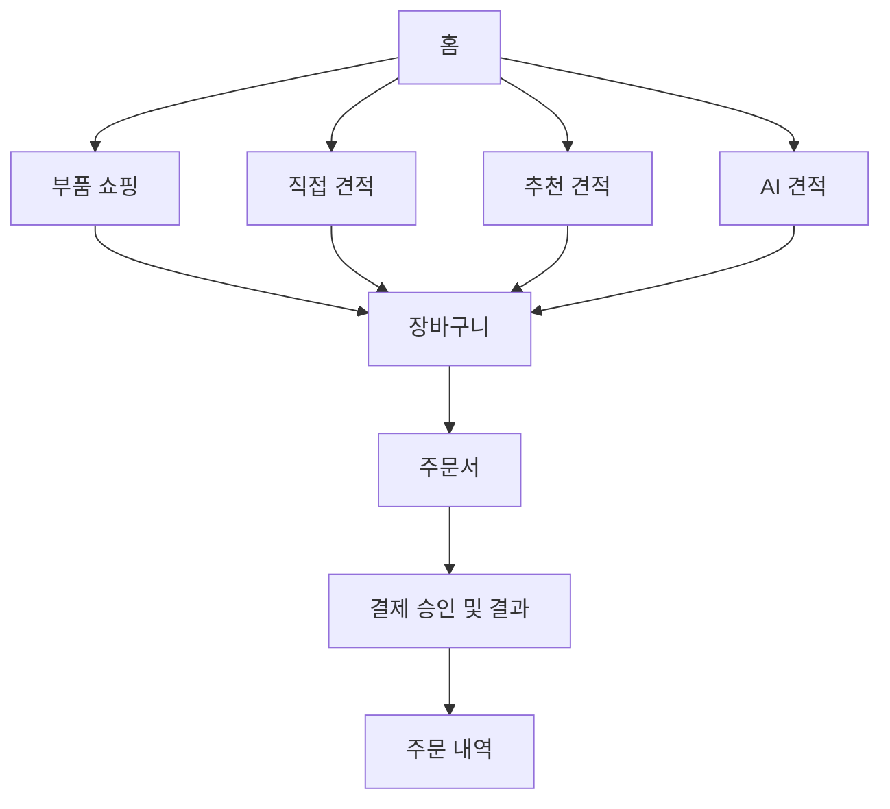

# COMPICK — 조립 PC 쇼핑몰

사용자가 부품을 직접 고르거나 추천 견적과 AI 견적을 참고하여 조립 PC를 구성하고, 장바구니에서 주문으로 이어갈 수 있도록 구현한 쇼핑몰 프로젝트입니다.

현재 보관된 소스의 컨트롤러·서비스·화면 템플릿을 기준으로 기능을 정리하였습니다. 외부 서비스 연동과 데이터베이스를 연결한 실행 검증은 이번 문서 작업에 포함하지 않았습니다.

## 주요 기능

- 카테고리·브랜드·가격·상세 사양 조건으로 PC 부품을 탐색하도록 구현하였습니다.
- 부품을 직접 선택하는 견적과 미리 구성한 추천 견적을 제공하였습니다.
- 자연어 요구사항을 Gemini에 전달하고, 추천 결과를 상품 정보와 연결하도록 구현하였습니다.
- 개별 상품과 견적을 장바구니에서 관리하고 주문하도록 구현하였습니다.
- 회원가입·로그인·이메일 인증·계정 찾기·배송지 관리 기능을 구현하였습니다.
- 주문 조회, 취소·반품 요청과 결제 결과 화면을 구현하였습니다.
- 관리자용 상품·추천 견적·회원·주문·AI 추천 로그 관리 화면을 구현하였습니다.

## 구현 방식

| 구성 | 사용 기술 |
|---|---|
| 서버 | Java 21, Spring Boot 3.5.16, Spring MVC |
| 화면 | Thymeleaf, HTML, CSS, JavaScript |
| 데이터 접근 | Spring Data JPA, Oracle용 SQL 스키마 |
| 인증 | Spring Security, OAuth2/OIDC 로그인 연동 코드 |
| 외부 연동 | Gemini, 이메일 발송, Toss Payments 결제 승인 |

## 상세 문서

- [페이지별 설명](docs/PAGES.md): 사용자·회원·관리자 화면과 연결 경로를 정리하였습니다.
- [주요 기능 설명](docs/FEATURES.md): 상품 탐색, 견적, AI 추천, 장바구니·주문과 권한 처리를 정리하였습니다.

화면 파일이 존재하는 것과 외부 서비스까지 정상 연결되어 동작하는 것은 구분하였습니다. 코드에서 확인한 기능만 기재하였으며 성능 수치나 담당자별 기여도는 추정하지 않았습니다.

## 보관 범위

개인 접속 설정, 업로드 파일과 빌드 산출물은 제외하였습니다. 설정 항목은 [환경 설정 예시](src/main/resources/application-example.properties)에 정리하였습니다.
