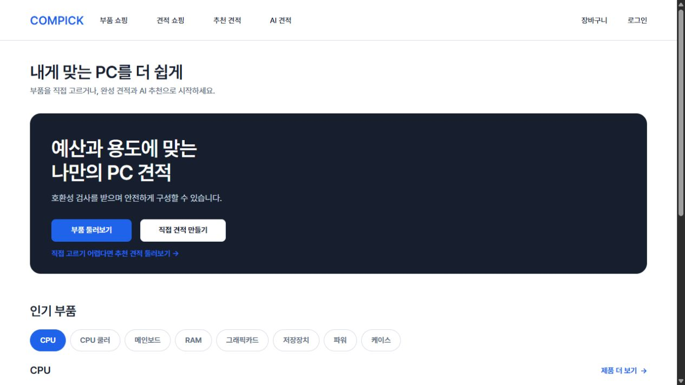
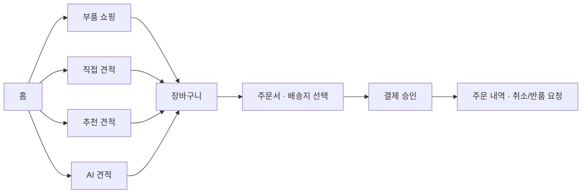
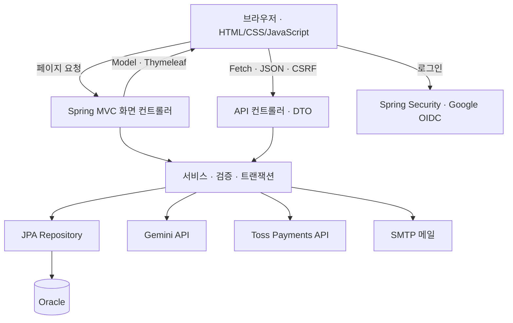

# COMPICK — 조립 PC 쇼핑몰

부품을 직접 고르거나 추천 견적·AI 견적으로 PC를 구성하고, 장바구니에서 주문과 결제로 이어갈 수 있도록 개발한 쇼핑몰 팀 프로젝트입니다.

 

부품을 잘 아는 사용자는 조건별 탐색과 직접 견적을, 구성이 어려운 사용자는 용도별 추천과 자연어 요구사항 입력을 이용하도록 하였습니다. 회원의 구매 흐름과 함께 상품·견적·주문을 관리하는 관리자 화면도 구현하였습니다.

 

## 주요 기능

| 기능 | 구현 내용 |
|---|---|
| 부품 쇼핑 | 8개 부품 카테고리, 제조사·가격·상세 사양 필터, 정렬, 상품 상세 모달 |
| 직접 견적 | 구성 부품·수량 관리, 호환성 안내, 예상 소비전력·합계 표시, 조립 방식 선택 |
| 추천·AI 견적 | 용도별 완성 견적, 자연어 요구사항 기반 Gemini 추천, 실제 상품 연결 |
| 장바구니·주문 | 개별 상품·견적 통합 관리, 주문 대상 선택, 배송지 지정, 주문 생성 |
| 결제·구매 내역 | Toss Payments 승인·취소 연동, 재고 처리, 주문 상태별 조회·취소·반품 요청 |
| 회원·관리자 | 이메일 인증·계정 복구·배송지 관리, 관리자 상품·견적·회원·주문·AI 로그 관리 |

 

## 서비스 흐름

 

## 기술 구성

| 영역 | 사용 기술과 역할 |
|---|---|
| 프론트엔드 | Thymeleaf, HTML, CSS, JavaScript — 서버 렌더링과 Fetch API 기반 화면 갱신 |
| 백엔드 | Java 21, Spring Boot 3.5.16, Spring MVC — 화면·API 요청 처리와 도메인 서비스 |
| 데이터 | Spring Data JPA, Oracle — 상품·견적·장바구니·주문·결제·회원 데이터 관리 |
| 인증 | Spring Security, OAuth2/OIDC — 로그인·세션·권한 제어 |
| 외부 서비스 | Gemini, Toss Payments, 이메일 발송 — 견적 추천·결제·계정 인증 |

 

## 구현 방식

 

### 서버 구성

Java 21과 Spring Boot 3.5.16을 사용하고, 내장 Tomcat에서 Spring MVC 애플리케이션을 실행하도록 구성하였습니다. 화면과 API를 같은 서버에서 제공하며, 상품·견적·장바구니·주문·결제·회원 기능을 도메인별 패키지로 구분하였습니다.

 

컨트롤러는 요청과 응답을 처리하고, 서비스는 검증·금액 계산·소유자 확인·상태 변경을 담당하도록 구성하였습니다. 데이터 조회와 저장은 Spring Data JPA의 Repository로 분리하고, 여러 데이터가 함께 변경되는 주문·결제 처리에는 서비스 단위 트랜잭션을 적용하였습니다.

 

### 화면 구현

HTML·CSS·Thymeleaf로 화면을 작성하고, 서버가 전달한 데이터를 HTML로 렌더링하도록 하였습니다. 헤더·푸터 등 공통 영역은 템플릿 조각으로 구성하였습니다.

 

JavaScript는 카테고리 전환, 상품 필터, 상세 모달, 견적 선택, 장바구니 수량 변경 등 화면 내 상호작용을 처리하도록 하였습니다. 변경이 잦은 영역은 Fetch API로 JSON 데이터를 받아 갱신하고, 견적 화면에서는 선택 부품·호환성 안내·총금액을 함께 갱신하도록 구현하였습니다.

 

### 컨트롤러와 API 처리

화면을 반환하는 `@Controller`와 JSON 데이터를 반환하는 `@RestController`를 구분하였습니다. 화면 요청에는 Model과 Thymeleaf 템플릿을 사용하고, 비동기 요청에는 DTO를 사용하여 필요한 데이터를 전달하도록 하였습니다.

| 요청 예시 | 서버 처리 | 화면 반영 |
|---|---|---|
| `GET /products` | 초기 카테고리와 상품을 조회하여 Model에 전달 | 상품 목록 HTML 렌더링 |
| `GET /api/products` | 카테고리·가격·브랜드·사양 조건으로 검색하고 정렬·페이지 처리 | 조건에 맞는 상품 카드 갱신 |
| `GET /api/products/detail/{productId}` | 상품 상세 DTO 반환 | 상세 모달 표시 |
| `POST /api/cart/quotes` | 구성 상품 검증 후 견적 저장 및 장바구니 연결 | 저장 결과 안내 |
| `POST /api/orders` | 회원의 선택 항목·배송지를 확인하고 서버 가격으로 주문 생성 | 응답의 주문 번호·금액으로 결제창 요청 |
| `POST /ai-quotes` | 입력 검증, Gemini 추천 요청, 상품 조회 및 개인 견적 저장 | 추천 설명·구성 부품·합계 표시 |

서버에서는 입력 검증과 함께 로그인 회원의 주문·배송지·견적 소유 여부를 확인하도록 하였습니다. 인증이 필요한 API에 비로그인 요청이 들어오면 401을 반환하고, 화면 요청은 로그인 페이지로 이동하도록 하였습니다. 브라우저의 데이터 변경 요청에는 CSRF 토큰을 전달하도록 구현하였습니다.

 

### 데이터 저장

Oracle을 기준으로 JPA 엔티티와 저장소를 구성하였습니다. 상품과 카테고리, 견적과 구성 부품, 회원별 장바구니, 주문·주문 그룹·주문 항목, 결제 정보를 구분하여 관리하도록 하였습니다.

 

주문 생성 시에는 상품명·단가·수량과 배송지 정보를 주문 데이터에 복사하여 저장하도록 하였습니다. 결제 승인에서는 저장된 주문 금액과 콜백 금액을 비교하고, 승인 결과에 따라 결제 정보·주문 상태·재고·장바구니를 갱신하도록 구현하였습니다.

 

### 외부 API와 서비스 연동

| 서비스 | 사용 목적 | 연동 방식 |
|---|---|---|
| Google Gemini API | 예산·용도에 맞는 PC 견적 추천 | 서버의 Google Gen AI SDK로 상품 CSV와 요구사항을 전달하고, 응답의 상품 식별값을 실제 상품 데이터와 연결 |
| Toss Payments | 카드 결제 요청·승인·취소 | 브라우저 SDK로 결제창을 요청하고, 서버에서 승인·취소 API 호출 및 주문 금액 검증 |
| Google OAuth2/OIDC | 소셜 로그인 | Spring Security OAuth2 Client로 로그인하고 사용자 계정과 연결 |
| SMTP 메일 서비스 | 가입·계정 찾기·비밀번호 재설정 인증 | Spring JavaMailSender로 인증번호 메일 발송 |

메일은 HTTP API가 아닌 SMTP 방식으로 연동하였습니다. Gemini·결제·소셜 로그인 인증 정보는 서버 설정에서 읽도록 구성하였습니다.

구현 코드와 기능별 처리 순서는 [기능과 구현 구조](docs/FEATURES.md)에 정리하였습니다.

 

## 상세 문서

- **[화면과 사용자 흐름](docs/PAGES.md)** — 실제 화면과 함께 탐색부터 구매·관리자까지 설명하였습니다.
- **[기능과 구현 구조](docs/FEATURES.md)** — 화면·API·서비스·데이터의 연결, 검증 규칙과 처리 순서를 설명하였습니다.

> 화면 이미지는 별도의 H2 데이터베이스에 프로젝트 상품 데이터를 넣어 실행한 실제 화면입니다. 문서에서 설명한 외부 서비스 연동 전체의 통합 검증 여부와 구현상 제한은 기능 문서에 정리하였습니다.
