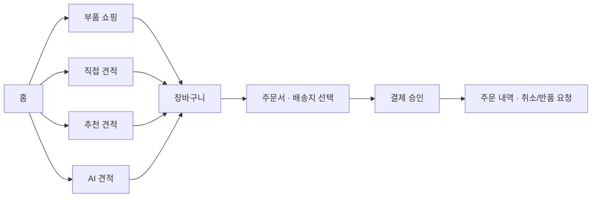

# COMPICK — 조립 PC 쇼핑몰

부품을 직접 고르거나 추천 견적·AI 견적으로 PC를 구성하고, 장바구니에서 주문과 결제로 이어갈 수 있도록 개발한 쇼핑몰 팀 프로젝트입니다.

부품을 잘 아는 사용자는 조건별 탐색과 직접 견적을, 구성이 어려운 사용자는 용도별 추천과 자연어 요구사항 입력을 이용하도록 하였습니다. 회원의 구매 흐름과 함께 상품·견적·주문을 관리하는 관리자 화면도 구현하였습니다.

## 주요 기능

| 기능 | 구현 내용 |
|---|---|
| 부품 쇼핑 | 8개 부품 카테고리, 제조사·가격·상세 사양 필터, 정렬, 상품 상세 모달 |
| 직접 견적 | 구성 부품·수량 관리, 호환성 안내, 예상 소비전력·합계 표시, 조립 방식 선택 |
| 추천·AI 견적 | 용도별 완성 견적, 자연어 요구사항 기반 Gemini 추천, 실제 상품 연결 |
| 장바구니·주문 | 개별 상품·견적 통합 관리, 주문 대상 선택, 배송지 지정, 주문 생성 |
| 결제·구매 내역 | Toss Payments 승인·취소 연동, 재고 처리, 주문 상태별 조회·취소·반품 요청 |
| 회원·관리자 | 이메일 인증·계정 복구·배송지 관리, 관리자 상품·견적·회원·주문·AI 로그 관리 |

## 서비스 흐름

## 기술 구성

| 영역 | 사용 기술과 역할 |
|---|---|
| 프론트엔드 | Thymeleaf, HTML, CSS, JavaScript — 서버 렌더링과 Fetch API 기반 화면 갱신 |
| 백엔드 | Java 21, Spring Boot 3.5.16, Spring MVC — 화면·API 요청 처리와 도메인 서비스 |
| 데이터 | Spring Data JPA, Oracle — 상품·견적·장바구니·주문·결제·회원 데이터 관리 |
| 인증 | Spring Security, OAuth2/OIDC — 로그인·세션·권한 제어 |
| 외부 서비스 | Gemini, Toss Payments, 이메일 발송 — 견적 추천·결제·계정 인증 |

## 상세 문서

- **[화면과 사용자 흐름](docs/PAGES.md)** — 실제 화면과 함께 탐색부터 구매·관리자까지 설명하였습니다.
- **[기능과 구현 구조](docs/FEATURES.md)** — 화면·API·서비스·데이터의 연결, 검증 규칙과 처리 순서를 설명하였습니다.

> 화면 이미지는 별도의 H2 데이터베이스에 프로젝트 상품 데이터를 넣어 실행한 실제 화면입니다. 문서에서 설명한 외부 서비스 연동 전체의 통합 검증 여부와 구현상 제한은 기능 문서에 정리하였습니다.
