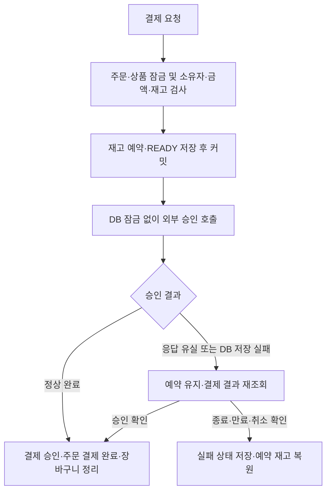

# 개선 반영

[프로젝트 소개](../README.md) · [기능 구현](FEATURES.md)

개선 코드는 [reforege](../reforege)에 정리하였습니다.

## 개선 내용

| 항목 | 내용 |
|---|---|
| 주문·재고 동시 처리 | UUID 주문 번호, 주문·상품 행 잠금, 구매 항목의 중복 삭제 처리 |
| 결제 안정성 | 재고 예약과 외부 승인 분리, 승인 결과 재조회·복구 |
| 견적 검증 | 필수 부품·수량·판매 상태·호환성의 서버 공통 검사 |
| 화면 상태 처리 | 중복 요청 방지, 오류 안내, 조회 재시도, 요구사항 입력값 유지 |
| AI 추천 검증 | DB 상품 ID 연결, 현재 가격 기준 예산·구성 검사 |
| 상품 데이터 관리 | 정규화·중복 제거·상품 선정과 CSV·SQL 생성 스크립트 |
| 취소·반품 정책 | 반품 요청·관리자 승인 분리, 승인 시 환불 및 재고 복원 |
| 구매 흐름 테스트 | 동시 구매·중복 승인·결제 복구·견적 검증 등의 자동 테스트 |

## 1. 주문·재고 동시 처리

| 처리 | 기존 | 개선 |
|---|---|---|
| 주문 번호 | 당일 주문 수에 1을 더하여 생성 | 날짜와 UUID로 생성하고 DB 고유 제약조건 유지 |
| 같은 주문의 동시 승인 | 여러 요청이 결제 대기 상태를 읽고 진입 가능 | 주문 행 잠금과 처리 기한으로 중복 진행 제한 |
| 다른 주문의 동일 상품 구매 | 같은 재고를 읽은 뒤 각각 차감 가능 | 상품 행 잠금 후 최신 재고로 예약·차감 |
| 여러 상품의 잠금 | 상품 잠금 순서 없음 | 상품 ID 오름차순으로 잠금 획득 |
| 취소·반품의 재고 복원 | 다른 결제의 차감과 경합 가능 | 차감과 같은 상품 잠금 규칙 적용 |
| 구매 후 장바구니 정리 | 이미 삭제된 항목의 재삭제가 결제 저장에 영향을 줄 수 있음 | 회원 범위의 조건부 삭제로 이미 없는 항목 정상 처리 |

주문 번호를 `CP + yyyyMMdd + UUID(하이픈 제외)`의 42자리로 변경하였습니다. 주문 수 조회에 의존하지 않으며, 기존 50자리 컬럼과 고유 제약조건을 유지하였습니다.

주문 행을 먼저 잠근 후 상품을 ID 순으로 잠그도록 하였습니다. 재고 예약·복원은 공통 서비스로 모으고, 주문별 차감·복원 기록으로 중복 처리를 방지하였습니다. 관리자 상품·주문 수정에도 행 잠금을 적용하였습니다.

## 2. 결제 안정성

### 외부 승인과 DB 저장 분리

외부 결제 호출을 기다리는 동안 DB 잠금을 유지하지 않도록 승인 절차를 나누었습니다. 먼저 짧은 트랜잭션에서 주문 소유자·금액을 검사하고, 재고 예약과 `READY` 결제 정보를 저장하도록 하였습니다. 이후 외부 승인을 호출하고, 승인 결과가 주문 번호·결제 키·금액과 일치하면 별도 트랜잭션에서 결제 완료를 반영하도록 하였습니다.

### 중복 요청과 복구

- 동일 결제의 승인·취소 요청에는 일정한 `Idempotency-Key`를 사용하도록 하였습니다.
- 처리 중에는 60초의 처리 기한을 기록하고, 이미 승인된 결제의 반복 요청은 완료 상태를 반환하도록 하였습니다.
- 네트워크 오류만으로 결제 실패를 확정하거나 재고를 복원하지 않도록 하였습니다. 저장한 결제 키로 조회하여 실제 결과를 반영하도록 하였습니다.
- 주문 상세의 **결제 상태 확인** 버튼과 기본 60초 주기의 복구 작업을 추가하였습니다. 복구 작업은 처리 기한이 지난 `READY` 결제를 한 번에 최대 20건 조회하도록 하였습니다.
- 결제 실패 화면에서 기존 주문 상태로 이동하도록 하여, 결과가 불확실할 때 새 주문으로 바로 결제하지 않도록 구성하였습니다.

복구 판단은 결제사의 조회 응답에 의존하므로, 외부 서비스에 계속 접속할 수 없으면 예약 상태가 유지되도록 하였습니다.

## 3. 견적 검증

화면의 검사만 통과하면 저장할 수 있었던 구성을 서버의 공통 검증으로 보완하였습니다. 견적 저장·수정, 기존 견적의 장바구니 추가, AI 견적 검사·저장에 같은 기준을 적용하였습니다.

| 검사 | 기준 |
|---|---|
| 필수 구성 | CPU·쿨러·메인보드·RAM·GPU·저장장치·파워·케이스의 8개 카테고리 |
| 수량·판매 상태 | 양수 수량, 단일 부품 카테고리의 중복 제한, 판매 중 여부와 재고 |
| CPU·RAM | CPU 소켓, 메인보드와 RAM의 메모리 규격 |
| 장착 규격 | 메인보드·케이스 크기, 그래픽카드 길이 |
| 용량 | 파워 용량, RAM 슬롯 수, 3.5인치 저장장치 베이 수 |

사양 값이 있는 경우 명시적인 충돌을 검사하도록 하였습니다. 사양 누락을 호환 가능으로 보증하지는 않으며, 모든 부품 조합을 판정하는 범용 호환성 엔진으로 확장하지는 않았습니다. RAM 슬롯 계산은 기존 프로젝트의 상품당 2개 구성 기준을 유지하였습니다.

## 4. 화면 상태 처리

| 상황 | 처리 |
|---|---|
| 요청 중 연속 클릭 | 같은 주소·방식의 변경 요청을 중복 실행하지 않고 버튼 비활성화 |
| 요청 완료·실패 | 버튼 상태와 로딩 표시 복원 |
| 조회 중 네트워크 오류 | GET 요청만 1회 재시도 |
| 주문·저장 등 변경 요청 오류 | 자동 재전송 없이 오류 안내 |
| 응답 지연 | 비동기 요청에 25초 제한 적용 |
| AI 요구사항 입력 | 같은 탭의 세션 저장소에 초안 유지, 실패 후 입력값 유지 |
| 서버 오류 | JSON 오류 응답과 사용자 안내 문구 통일 |

공통 요청 스크립트에서 CSRF 헤더와 JSON 요청 형식을 함께 처리하도록 하였습니다. 비동기 요청과 일반 폼 제출에 중복 제출 방지를 적용하고, 뒤로 가기로 복원된 화면에서는 버튼 잠금이 남지 않도록 하였습니다.

## 5. AI 추천 검증

이름이 같은 상품을 잘못 연결하지 않도록, AI에 전달하는 상품 목록을 판매 중이고 재고가 있는 DB 상품으로 구성하고 `DB-상품ID`를 사용하도록 하였습니다. 추천 응답에 없는 ID·중복 ID가 포함되면 결과를 거부하도록 하였습니다.

추천 결과를 표시하거나 저장하기 전에 현재 DB 상품을 다시 읽어 필수 구성·호환성·판매 상태·재고를 검사하고, 가격을 현재 DB 가격으로 대체하도록 하였습니다. 요구사항에 `100만원`, `1,000,000원`처럼 금액이 명시된 경우 총액이 예산을 초과하면 안내하도록 하였습니다. 저장 단계에서도 현재 가격의 예산 초과를 다시 검사하도록 하였습니다.

예산 검사는 처음 등장하는 원화 금액을 기준으로 하였습니다. 게임 성능·저소음 등 모든 자연어 조건을 충족한다고 판정하는 기능은 포함하지 않았습니다. 상품 목록은 추천 서비스 초기화 시 구성하도록 하였습니다.

## 6. 상품 데이터 관리

과거 최종 CSV만으로는 원본에서 어떤 기준으로 상품을 골랐는지 재현하기 어려워, 이후 갱신에 사용할 전처리 도구를 추가하였습니다. 기존 543개 상품의 과거 선정 과정을 새로 복원하였다고 기재하지는 않았습니다.

| 단계 | 처리 |
|---|---|
| 입력 | CSV 또는 JSONL, 유로화 가격은 명시한 환율로 변환 |
| 정규화 | 8개 카테고리 통일, CPU·케이스 사양 키 정리, 원화 가격 100원 단위 반올림 |
| 유효성 검사 | 상품명·브랜드·사양·가격·평가 수·이미지 주소 검사 |
| 중복 제거 | 카테고리·브랜드·상품명·정규화된 사양이 같은 상품 통합 |
| 선정 | 평가 수 내림차순·가격 오름차순·고정 식별값 순 정렬, 선택적으로 카테고리별 개수 제한 |
| 출력 | 상품 CSV, Oracle MERGE SQL, 입력 해시·설정·제외 건수 기록 |

현재 CSV 543행에 적용하여 사양까지 같은 중복 12행을 제외한 **531행**을 생성하였습니다. 생성 SQL의 재적용 시 기존 재고와 판매 상태를 덮어쓰지 않도록 하였습니다. 생성 결과는 운영 DB에 적용하지 않았습니다.

도구: [상품 전처리](../reforege/tools/prepare_products.py)

## 7. 취소·반품 정책

| 처리 | 기존 | 개선 |
|---|---|---|
| 반품 요청 | 요청 시 즉시 50% 환불 | 반품 요청만 기록하고 관리자 승인 대기 |
| 관리자 승인 | 별도 승인 절차 없음 | 배송 중·배송 완료 주문의 반품 요청을 승인한 뒤 남은 결제 잔액 전액 환불 |
| 완료 상태 | 요청과 처리 완료 구분 부족 | 반품 요청·반품 완료와 완료 시각 구분 |
| 반복 처리 | 환불·재고 복원 중복 위험 | 결제 상태·잔액·재고 복원 기록 검사 |
| 결제 결과 미확정 주문 취소 | 승인 여부와 취소가 엇갈릴 수 있음 | 저장된 결제를 먼저 조회·복구한 뒤 처리 |
| 관리자 주문 상태 | 임의 상태 변경 가능 | 결제 완료→배송 준비→배송 중→배송 완료 순서로 제한 |

취소·반품은 주문 소유권과 상태를 검사하도록 하였습니다. 반품 승인 API는 관리자 권한으로 제한하고, 환불과 재고 복원을 같은 주문의 잠금 아래 처리하도록 하였습니다. 외부 취소 후 DB 저장에 실패한 경우 재시도 시 결제 잔액을 확인하여 이미 처리된 외부 환불을 중복 호출하지 않도록 하였습니다.

## 8. 자동 테스트

| 범위 | 테스트 수 | 주요 조건 |
|---|---:|---|
| 기존 Java 테스트 | 38 | 인증·회원·상품·견적·주문 등의 기존 동작 |
| 주문·결제·재고 | 12 | 동시 주문·재고 경합·중복 승인·복구·소유권·반품 승인 |
| 공통 견적·AI 검사 | 14 | 필수 구성·규격 충돌·재고·예산·알 수 없는 상품 |
| 상품 전처리 | 7 | 정규화·환율·중복 제거·재현성·SQL 생성 |
| 공통 요청 처리 | 4 | 중복 요청·버튼 복원·조회 재시도·변경 요청 비재시도·CSRF |
| 합계 | **75** | Java 64개 · Python 7개 · JavaScript 4개 |

### 주요 시나리오

| 조건 | 결과 |
|---|---|
| 회원 12명의 동시 주문 생성 | 서로 다른 주문 번호 12개 저장 |
| 재고 3개에 주문 8건 동시 결제 | 3건 승인, 잔여 재고 0개 |
| 같은 주문의 승인 요청 8건 | 외부 승인 1회, 재고 1회 차감 |
| 외부 호출 중 DB 트랜잭션 확인 | 승인 호출 시 DB 트랜잭션 비활성 |
| 외부 승인 후 로컬 저장 실패 | 저장된 결제 키 재조회로 복구, 추가 승인 없이 완료 |
| 외부 결제 종료 확인 | 실패 상태 저장 및 예약 재고 복원 |
| 상품 선택 순서가 반대인 두 주문 | 동일한 상품 잠금 순서로 처리 완료 |
| 기존 주문 취소와 새 결제 경합 | 재고 복원·차감 후 기대 재고 유지 |
| 반품 요청 후 관리자 승인 반복 | 요청 단계 환불 없음, 승인 시 전액 환불·재고 복원 각 1회 |
| 다른 회원의 주문·잘못된 결제 금액 | 승인 호출 전 차단 |

Java 테스트는 H2의 실제 트랜잭션·행 잠금을 사용하고, 결제·Gemini 호출은 모킹하였습니다. Oracle 실서버의 동시 처리와 실제 결제사 연동을 측정한 결과는 포함하지 않았습니다.

## DB 변경

결제 처리 기한과 반품 완료 시각 컬럼을 추가하고, 외부 결제 식별값 길이를 200자로 확장하였습니다. 기존 DB용 [변경 SQL](../reforege/docs/sqls/compick_reforege_migration.sql)과 신규 구축용 스키마를 함께 정리하였습니다. 기존 반품 데이터는 과거 환불 내역을 대조한 뒤 완료 상태를 이관하도록 주석을 남겼습니다.
