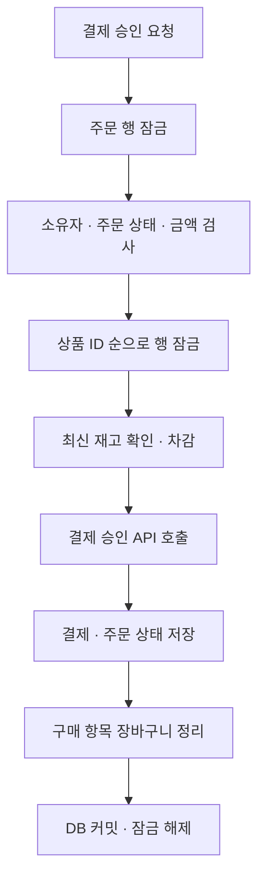

# 개선 반영

[프로젝트 소개](../README.md) · [기능 구현](FEATURES.md)

## 개선 내용

| 항목 | 내용 |
|---|---|
| 주문·재고 동시 처리 | UUID 주문 번호, 주문·상품 행 잠금, 구매 완료 항목의 중복 삭제 처리 |
| 결제 안정성 | 외부 승인과 DB 저장 결과가 달라졌을 때의 복구 흐름 |
| 견적 검증 | 서버의 공통 호환성 검사 |
| 화면 상태 처리 | 요청·실패·재시도 흐름 통일 |
| AI 추천 검증 | 예산·필수 부품·호환성 검사 |
| 상품 데이터 관리 | 전처리·선정 기준 재현 |
| 취소·반품 정책 | 상태와 환불 기준 정리 |
| 구매 흐름 테스트 | 주문·재고 동시 처리 테스트 추가, 나머지 흐름은 후속 보강 |

## 1. 주문·재고 동시 처리

### 변경 전후

| 처리 | 기존 | 개선 |
|---|---|---|
| 주문 번호 | 당일 주문 수를 조회한 뒤 1을 더하여 생성 | 날짜와 UUID로 생성하고 기존 DB 고유 제약조건 유지 |
| 같은 주문의 동시 승인 | 각각 결제 대기 상태를 읽고 승인에 진입 가능 | 주문 행을 잠근 뒤 상태를 검사하여 한 요청만 승인 처리 |
| 다른 주문의 동일 상품 구매 | 같은 재고를 읽은 뒤 각각 차감 가능 | 상품 행을 잠그고 최신 재고를 기준으로 차감 |
| 여러 상품 구매 | 상품 잠금 순서 없음 | 상품 ID 오름차순으로 잠금을 획득 |
| 취소·반품 재고 복원 | 다른 결제의 차감과 겹칠 수 있음 | 재고 차감과 같은 상품 잠금 규칙 적용 |
| 관리자 변경 | 상품·주문을 잠금 없이 조회 후 수정 | 기존 상품·주문 수정 시 같은 행 잠금 적용 |
| 장바구니 정리 | 이미 삭제된 항목을 다시 삭제할 때 예외가 전체 거래를 롤백시킬 수 있음 | 회원 장바구니 범위의 조건부 삭제로 변경하여 없는 항목은 정상 처리 |

### 주문 번호

주문 수 조회에 의존하던 번호 생성을 `CP + yyyyMMdd + UUID(하이픈 제외)`로 변경하였습니다. 42자리로 기존 50자리 컬럼 안에 저장하며, 기존 주문 번호와 결제 콜백 조회는 그대로 사용할 수 있도록 하였습니다. 번호의 최종 중복 방지는 DB의 고유 제약조건이 담당하도록 유지하였습니다.

### 주문·재고 잠금

`PESSIMISTIC_WRITE`로 주문 행을 먼저 잠근 후 소유자·결제 대기 상태를 검사하도록 하였습니다. 여러 상품은 ID 오름차순으로 하나씩 잠그고 재고를 차감하도록 하여 서로 다른 선택 순서의 주문이 같은 잠금 순서를 따르도록 구성하였습니다.

취소·반품과 관리자 변경에도 동일한 행 잠금을 적용하였습니다. 일반 상품 조회와 주문 내역 조회는 기존 조회 방식을 유지하였습니다. 잠금은 해당 DB 트랜잭션이 끝날 때 해제되도록 하였습니다.

### 장바구니 정리

동일 회원의 여러 주문을 처리하는 과정에서, 앞선 결제가 장바구니 항목을 삭제하면 다음 결제가 이미 없는 항목을 다시 삭제하다 롤백되는 문제가 나타났습니다. 구매 완료 항목은 조건에 맞는 행만 삭제하고, 이미 없는 경우에는 정상적으로 끝내도록 변경하였습니다. 사용자가 직접 누르는 장바구니 삭제 API의 동작은 유지하였습니다.

### 테스트 결과

| 조건 | 결과 |
|---|---|
| 회원 12명의 주문 생성 동시 요청 | 서로 다른 주문 번호 12개 저장 |
| 재고 3개에 서로 다른 주문 8건 동시 결제 | 3건 승인, 5건 재고 부족, 잔여 재고 0개 |
| 같은 주문의 승인 요청 8건 | 1건 승인, 결제 API 1회 호출, 재고 1회 차감 |
| 결제 API가 예외를 반환 | 재고·주문 상태 롤백, 결제 정보 미생성 |
| 상품 2개를 반대 순서로 선택한 주문 동시 결제 | 두 주문 처리 완료, 상품별 잔여 재고 0개 |
| 기존 결제 취소와 새 주문 결제를 동시 요청 | 재고 복원·차감 후 기대 재고 유지 |

새 동시 처리 테스트 6개와 기존 테스트 38개를 포함한 **전체 44개 테스트를 통과하였습니다.** 테스트는 H2의 실제 트랜잭션·행 잠금을 사용하고, 외부 결제·Gemini 호출은 모킹하였습니다. Oracle 실서버의 잠금 동작과 처리량 측정은 별도 실행 대상입니다.

기존 인기 상품 테스트에는 CPU 카테고리 준비 데이터가 빠져 있어, 해당 테스트가 필요한 카테고리를 직접 준비하도록 보완하였습니다.

### 후속 범위

이번 변경은 동일 DB의 동시 요청에서 주문 상태와 재고 변경을 직렬화하는 데 집중하였습니다. 외부 결제 승인 후 DB 커밋 실패를 복구하는 처리와 결제 API의 네트워크 대기 중 잠금 유지 시간 개선은 다음 결제 안정성 항목에서 진행합니다.
