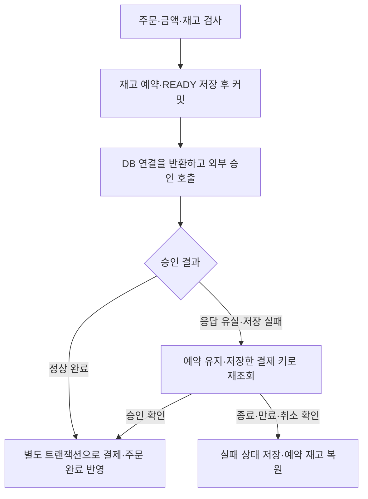
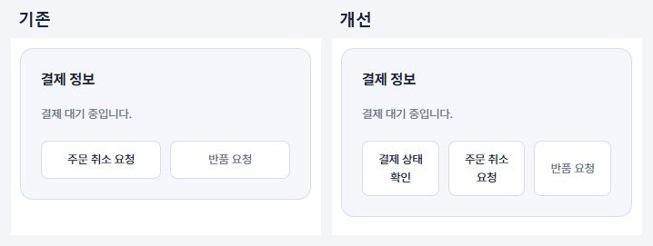
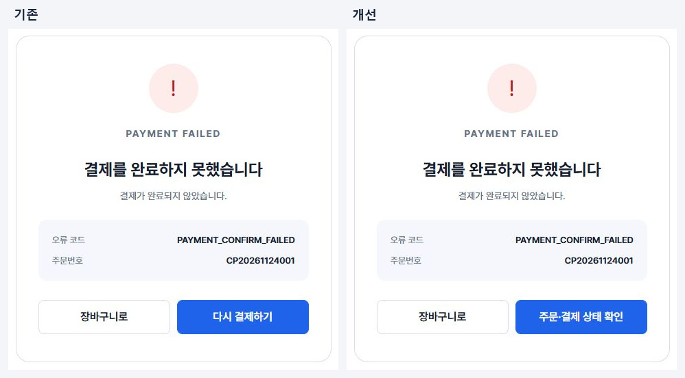
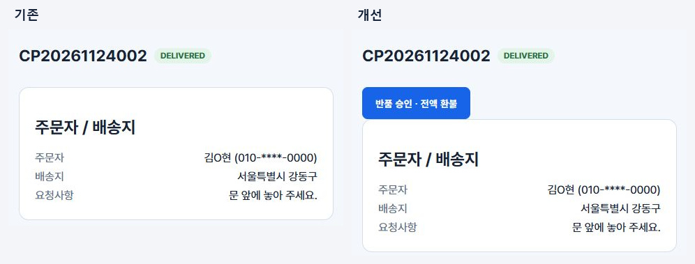

# 개선사항

[프로젝트 소개](../README.md)

교육 수료 이후 주문·결제 안정성, 서버 검증, 요청 처리와 데이터 관리 방식을 보완하였습니다. 각 항목에 기존 문제와 변경 내용, 개선효과를 정리하고 화면이 달라진 항목에는 비교 이미지를 함께 배치하였습니다.

## 1. 주문·재고 동시 처리

### 기존 문제

당일 주문 수에 1을 더하는 방식으로 주문 번호를 생성하여 동시 요청에서 충돌할 수 있었습니다. 여러 주문이 같은 상품의 재고를 읽은 뒤 각각 차감하거나, 같은 주문의 승인 요청이 겹치는 상황을 제어하는 행 잠금이 없었습니다. 구매 후 이미 삭제된 장바구니 항목을 다시 삭제하면 예외가 결제 저장에 영향을 줄 수 있었습니다.

### 변경 내용

| 처리 | 개선 |
|---|---|
| 주문 번호 | `CP + yyyyMMdd + UUID`의 42자리로 생성하고 DB 고유 제약조건 유지 |
| 같은 주문의 동시 처리 | 주문 행을 잠근 후 소유자·상태를 검사 |
| 상품 재고 | 상품 ID 오름차순으로 행을 잠그고 최신 재고로 차감·복원 |
| 중복 재고 처리 | 주문별 차감·복원 기록을 확인하는 공통 서비스 적용 |
| 관리자 수정 | 상품·주문 수정에도 동일한 행 잠금 적용 |
| 장바구니 정리 | 회원 범위의 조건부 삭제로 이미 없는 구매 항목은 정상 처리 |

### 개선효과

주문 번호 생성에서 주문 수 조회 의존성을 없애고, 재고 변경을 동일한 잠금 규칙 아래 처리하도록 하였습니다. 동시 처리 테스트에서 다음 결과를 얻었습니다.

| 조건 | 결과 |
|---|---|
| 회원 12명의 동시 주문 생성 | 서로 다른 주문 번호 12개 저장 |
| 재고 3개에 주문 8건 동시 결제 | 3건 승인, 잔여 재고 0개 |
| 상품 선택 순서가 반대인 두 주문 | 같은 잠금 순서로 처리 완료 |
| 기존 주문 취소와 새 결제의 경합 | 복원·차감 후 기대 재고 유지 |

## 2. 결제 안정성과 처리 지연

### 기존 문제

외부 승인 응답을 기다리는 동안 DB 트랜잭션과 연결을 유지하였습니다. DB 연결이 부족하면 다른 요청이 승인 대기 시간만큼 밀릴 수 있었습니다. 또한 외부 승인은 끝났지만 응답이 유실되거나 DB 저장에 실패하면, 실제 결제 결과와 로컬 주문 상태가 달라질 수 있었습니다.

### 변경 내용

먼저 짧은 트랜잭션에서 주문 소유자·금액·재고를 검사하고, 재고 예약과 `READY` 결제 정보를 저장하도록 하였습니다. DB 연결을 반환한 뒤 외부 승인을 호출하고, 응답의 주문 번호·결제 키·금액·완료 상태가 일치하면 별도 트랜잭션에서 결제 완료를 반영하도록 하였습니다.

같은 결제의 승인·취소에는 일정한 `Idempotency-Key`를 사용하고, 처리 중에는 60초의 처리 기한을 기록하도록 하였습니다. 이미 승인된 요청은 완료 상태를 반환하며, 네트워크 오류만으로 실패를 확정하거나 재고를 복원하지 않도록 하였습니다. 기본 60초 주기의 복구 작업에서 처리 기한이 지난 결제를 최대 20건씩 재조회하도록 하였습니다.

### 개선효과

같은 주문의 승인 요청 8건에서 외부 승인과 재고 차감을 각각 1회 처리하였습니다. 외부 승인 후 로컬 저장에 실패한 상황에서는 결제 키 재조회로 추가 승인 없이 완료 상태를 복구하였습니다. 외부 결제의 종료가 확인된 경우에는 예약 재고를 복원하도록 하였습니다.

외부 승인 대기 중 DB 연결을 반환하는 효과는 다음 조건에서 비교 측정하였습니다.

| 측정 조건 | 내용 |
|---|---|
| 비교 코드 | `76ac6ee`의 루트 코드와 `reforege` 코드 |
| 환경 | 동일 Windows PC, Java 21.0.10, Spring Boot 3.5.16, H2 2.3.232 Oracle 모드 |
| 부하 | **DB 연결 2개, 서로 다른 상품·주문 8건 동시 승인, 모의 승인 지연 500ms** |
| 표본 | 버전별 준비 요청 4건 후 5회 반복, 각 40건 측정 |
| 측정 범위 | `PaymentService.confirmToss` 진입부터 DB 반영 후 반환까지 |

| 지표 | 기존 | 개선 | 변화 |
|---|---:|---:|---:|
| 요청 평균 | 1,312.3ms | 536.8ms | 59.1% 감소 |
| 요청 중앙값 | 1,308.8ms | 537.1ms | 59.0% 감소 |
| 요청 P95 | 2,106.2ms | 551.6ms | 73.8% 감소 |
| 동시 8건 전체 완료 평균 | 2,098.2ms | 548.4ms | 73.9% 감소 |
| 외부 호출 중 DB 트랜잭션 활성 | 40/40회 | 0/40회 | 외부 대기를 트랜잭션에서 분리 |
| 결제 완료·재고 일치 | 40/40건 | 40/40건 | 모두 정상 완료 |

DB 연결이 승인 대기에 묶이지 않으면서 다른 요청의 대기 시간이 줄었습니다. **위 수치는 DB 연결 부족 상황을 재현한 모의 부하 결과이며, 실제 Toss Payments·Oracle·HTTP 전체의 응답속도 측정값은 아닙니다.** P95는 요청의 95%가 끝난 시간으로, 40개 표본 중 정렬 후 38번째 값을 사용하였습니다.

측정 원본: [기존](benchmarks/payment-before.json) · [개선](benchmarks/payment-after.json) · [집계](benchmarks/payment-summary.json)  
측정 코드: [Java 서비스 비교](../reforege/tools/ComparisonLauncher.java) · [격리 실행 도구](../reforege/tools/benchmark_payments.py)

### 화면 변경

주문 상세에 **결제 상태 확인** 버튼을 추가하였습니다. 승인 응답을 받지 못한 경우 같은 주문의 결제 결과를 다시 조회하여 상태를 반영하도록 하였습니다.

결제 실패 화면의 **다시 결제하기**는 **주문·결제 상태 확인**으로 변경하였습니다. 승인 여부가 불확실할 때 새 주문을 만들기보다 기존 주문의 상태를 먼저 확인하도록 연결하였습니다.

## 3. 견적 검증

### 기존 문제

서버에서는 필수 구성과 일부 수량을 검사하였지만, 부품 간 호환성 검사는 화면에 의존하는 부분이 있었습니다. 화면 검사를 우회하거나 저장된 견적의 상품 상태가 바뀌면 잘못된 구성이 구매 흐름으로 들어갈 수 있었습니다.

### 변경 내용

견적 저장·수정, 기존 견적의 장바구니 추가, AI 견적 검사·저장에 공통 검증을 적용하였습니다.

| 검사 | 기준 |
|---|---|
| 구성·수량 | 필수 8개 카테고리, 양수 수량, 단일 부품 카테고리 중복 제한 |
| 판매 상태 | 판매 중 여부와 현재 재고 |
| CPU·RAM | CPU·메인보드 소켓, 메인보드·RAM 메모리 규격 |
| 장착 규격 | 메인보드·케이스 크기, 그래픽카드 길이 |
| 용량 | 파워 용량, RAM 슬롯, 3.5인치 저장장치 베이 수 |

### 개선효과

화면의 검사 결과와 관계없이 서버가 같은 기준으로 구성을 검사하도록 하였습니다. 필수 부품 누락·수량 오류·재고 부족과 명시적인 규격 충돌을 저장·장바구니 추가 단계에서 거부하도록 보완하였습니다.

사양이 누락된 상품의 호환성을 보증하는 기능은 포함하지 않았습니다. RAM 슬롯 계산은 기존 상품당 2개 구성 기준을 유지하였습니다.

## 4. 화면 요청 처리

### 기존 문제

화면별로 요청 중 상태와 실패 처리가 나뉘어 있어, 연속 클릭·네트워크 오류·뒤로 가기에서 중복 제출이나 버튼 잠금이 남을 수 있었습니다.

### 변경 내용과 효과

| 상황 | 개선 | 효과 |
|---|---|---|
| 연속 클릭 | 같은 주소·방식의 변경 요청을 중복 실행하지 않고 버튼 비활성화 | 요청 중 중복 제출 제한 |
| 요청 완료·실패 | 버튼 상태와 로딩 표시 복원 | 실패 후 다시 조작할 수 있도록 처리 |
| 조회 실패 | GET 네트워크 오류만 1회 재시도 | 일시적인 조회 실패 대응 |
| 변경 요청 실패 | 자동 재전송 없이 안내 | 주문·저장 요청의 중복 실행 위험 축소 |
| 응답 지연 | 비동기 요청별 25초 제한 | 응답 없이 계속 기다리는 상황 제한 |
| AI 요구사항 | 같은 탭의 세션 저장소에 초안 유지 | 실패·새로고침 후 재입력 부담 감소 |
| 뒤로 가기 | 복원된 화면의 제출 잠금 해제 | 비활성 상태가 남는 문제 방지 |

CSRF 헤더와 JSON 요청 형식, 서버 오류 안내를 공통 처리로 모았습니다. 기존 화면 디자인은 유지하고 요청 중 비활성화·실패 안내·입력값 유지 동작을 보완하였습니다.

## 5. AI 추천 검증

### 기존 문제

추천 상품을 이름으로 연결하면 같은 이름의 다른 상품이 선택될 수 있었고, 응답에 잘못된 식별값이 포함되면 일부 부품이 빠질 수 있었습니다. 예산과 상품 구성의 적합성을 추천 응답에 의존하는 부분이 있었습니다.

### 변경 내용

추천용 목록을 판매 중이고 재고가 있는 DB 상품으로 구성하고 `DB-상품ID`를 사용하도록 하였습니다. 알 수 없는 ID·중복 ID를 거부하고, 표시·저장 전에 DB 상품을 다시 읽어 현재 가격·재고·필수 구성·호환성을 검사하도록 하였습니다.

요구사항에 `100만원`, `1,000,000원`처럼 원화 금액이 명시되면 현재 가격의 총액과 대조하도록 하였습니다. 저장 단계에서도 예산 초과를 다시 검사하도록 하였습니다.

### 개선효과

이름이 같은 상품의 오연결을 피하고, 존재하지 않거나 중복된 상품·예산 초과 구성이 그대로 저장되는 것을 막도록 보완하였습니다. 해당 조건의 거부 동작을 자동 테스트에 포함하였습니다.

예산은 처음 등장하는 원화 금액을 기준으로 검사하였습니다. 게임 성능·저소음 등 모든 자연어 조건의 충족 여부를 판정하는 기능은 포함하지 않았습니다. 추천용 목록은 서비스 초기화 시 구성하도록 하였습니다.

## 6. 상품 데이터 관리

### 기존 문제

최종 CSV만으로는 원본 데이터에서 상품을 정규화하고 선정한 기준을 재현하기 어려웠습니다.

### 변경 내용

이후 데이터 갱신에 사용할 [전처리 도구](../reforege/tools/prepare_products.py)를 추가하였습니다.

| 단계 | 처리 |
|---|---|
| 입력 | CSV·JSONL, 유로화 가격은 명시한 환율로 변환 |
| 정규화 | 8개 카테고리와 CPU·케이스 사양 키 통일, 원화 가격 100원 단위 반올림 |
| 유효성 검사 | 상품명·브랜드·사양·가격·평가 수·이미지 주소 검사 |
| 중복 제거 | 카테고리·브랜드·이름·정규화된 사양이 같은 상품 통합 |
| 선정 | 평가 수·가격·고정 식별값 순 정렬, 선택적으로 카테고리별 개수 제한 |
| 출력 | CSV·Oracle MERGE SQL·입력 해시·설정·제외 건수 |

### 개선효과

현재 CSV **543행에서 중복 12행을 제외한 531행**을 생성하였습니다. 동일한 입력과 설정에서 결과를 재현하고, SQL 재적용 시 기존 재고와 판매 상태를 유지하도록 하였습니다.

과거 543개 상품의 선정 과정을 복원하였다는 의미는 아닙니다. 생성 결과를 운영 DB에 적용하지 않았으므로 DB 용량·AI 토큰·조회 속도 감소 수치로 기재하지 않았습니다.

## 7. 취소·반품 처리

### 기존 문제

반품 요청 시 즉시 50% 환불을 진행하여 요청과 승인 단계가 분리되지 않았습니다. 요청·처리 완료의 구분과 반복 환불·재고 복원에 대한 제어가 부족하였습니다.

### 변경 내용

| 처리 | 기존 | 개선 |
|---|---|---|
| 반품 요청 | 요청 시 즉시 50% 환불 | 요청만 기록하고 관리자 승인 대기 |
| 환불 승인 | 별도 승인 절차 없음 | 관리자 승인 시 남은 결제 잔액 전액 환불 |
| 완료 상태 | 요청과 완료 구분 부족 | 반품 요청·완료 상태와 완료 시각 구분 |
| 반복 처리 | 환불·재고 복원 중복 위험 | 결제 상태·잔액·재고 복원 기록 검사 |
| 결제 결과 미확정 주문 | 승인 여부와 취소가 엇갈릴 수 있음 | 결제 결과를 먼저 조회·복구한 뒤 취소 |
| 관리자 주문 상태 | 임의 상태 변경 가능 | 결제 완료→배송 준비→배송 중→배송 완료 순서로 제한 |

### 개선효과

반품 요청만으로 환불하지 않고, 관리자 승인 시 환불과 재고 복원을 처리하도록 하였습니다. 테스트에서 요청 단계의 환불이 없고, 승인을 반복하여도 환불·재고 복원이 각각 1회 발생하도록 하였습니다.

외부 취소 후 DB 저장에 실패한 경우에는 재시도 시 잔액을 조회하여 이미 끝난 외부 환불을 중복 호출하지 않도록 하였습니다. 주문 소유권과 관리자 권한은 기존 보안 구성을 유지하면서 새 처리 경로에도 적용하였습니다.

### 화면 변경

반품 요청이 있는 관리자 주문 상세에 **반품 승인 · 전액 환불** 버튼을 추가하였습니다. 환불이 끝나면 완료 상태를 표시하도록 하였습니다.

## 8. 구매 흐름 테스트

### 기존 문제와 보완

기존 기능 테스트에 동시 구매, 중복 승인, 외부 승인 후 저장 실패, 잘못된 견적과 요청 재시도 조건을 추가하였습니다. 테스트용 이름은 **김O현**, 주소는 **서울특별시 강동구**로 통일하였습니다.

| 범위 | 테스트 수 | 주요 조건 |
|---|---:|---|
| 기존 Java 테스트 | 38 | 인증·회원·상품·견적·주문 |
| 주문·결제·재고 | 12 | 동시 주문·재고 경합·중복 승인·복구·소유권·반품 승인 |
| 공통 견적·AI 검사 | 14 | 필수 구성·규격 충돌·재고·예산·잘못된 상품 |
| 상품 전처리 | 7 | 정규화·환율·중복 제거·재현성·SQL 생성 |
| 공통 요청 처리 | 4 | 중복 요청·버튼 복원·조회 재시도·변경 요청 비재시도·CSRF |
| 합계 | **75** | Java 64개 · Python 7개 · JavaScript 4개 |

### 개선효과

실패·중복·동시 요청 조건을 반복 실행하여 기존 동작과 새 제어 로직을 함께 검사할 수 있도록 하였으며, 전체 75개 테스트를 통과하였습니다. 결제 지연 비교 80건은 자동 테스트 개수와 별도로 집계하였습니다.

Java 테스트는 H2의 실제 트랜잭션·행 잠금을 사용하고 결제·Gemini 호출은 모킹하였습니다. Oracle 실서버와 실제 결제사 연동의 성능·보안 전체를 검증한 결과로 표현하지 않았습니다. 기존 회원별 소유권 검사·관리자 권한·CSRF 구성을 새로 도입한 보안 기능으로 기재하지 않았습니다.

DB 변경은 결제 처리 기한·반품 완료 시각 추가와 결제 식별값 길이 확장입니다. 기존 DB용 [변경 SQL](../reforege/docs/sqls/compick_reforege_migration.sql)과 신규 구축 스키마를 정리하고, 기존 반품 데이터는 과거 환불 내역과 대조하여 이관하도록 주석을 남겼습니다.
