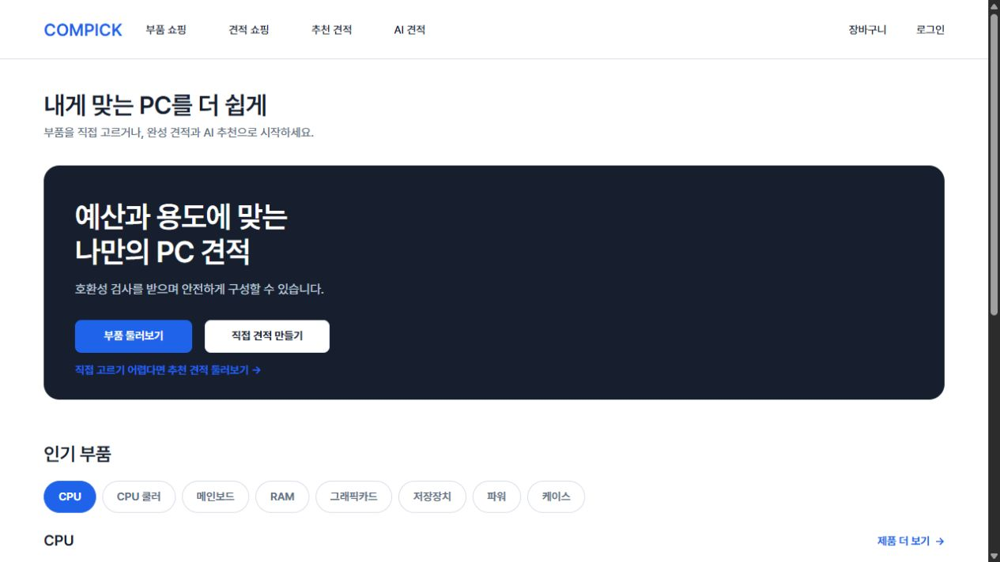
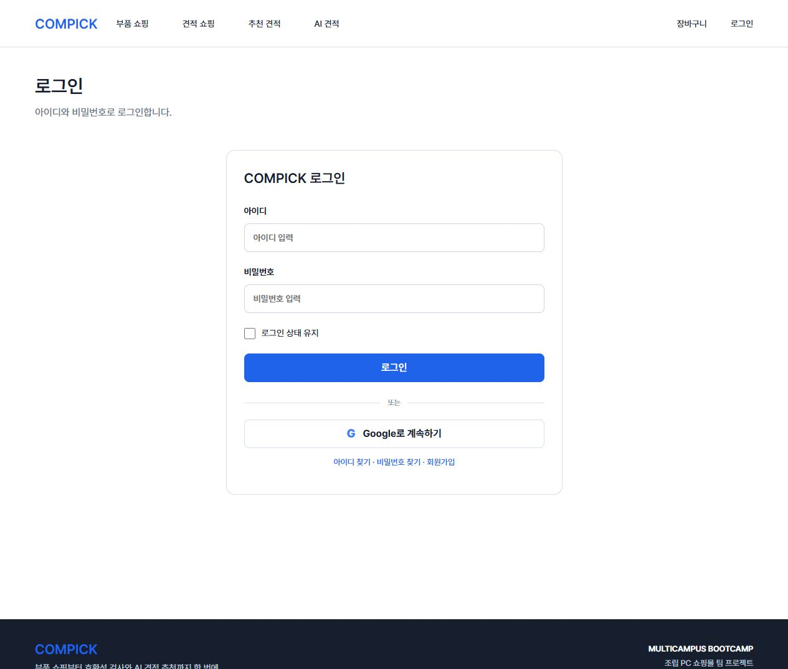
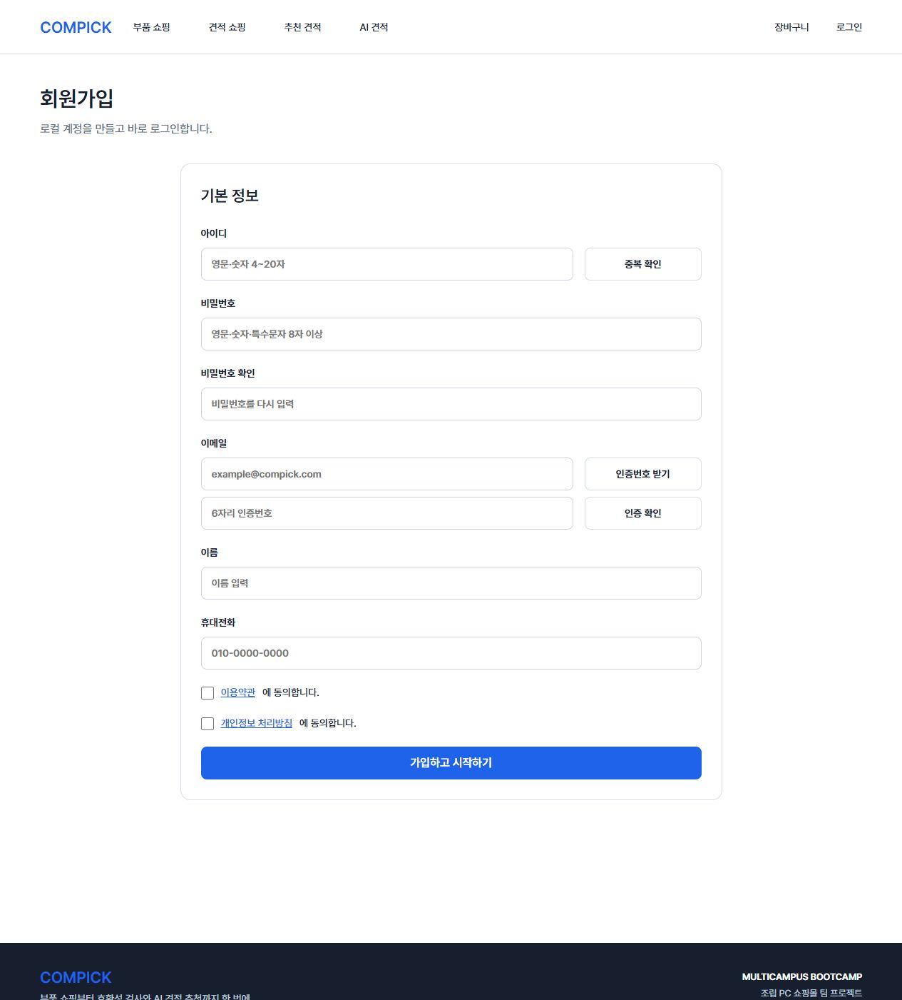
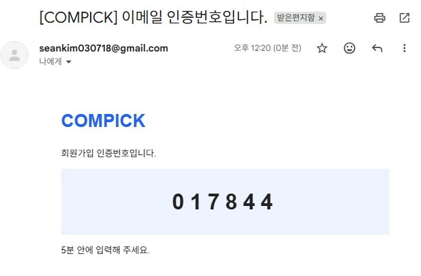
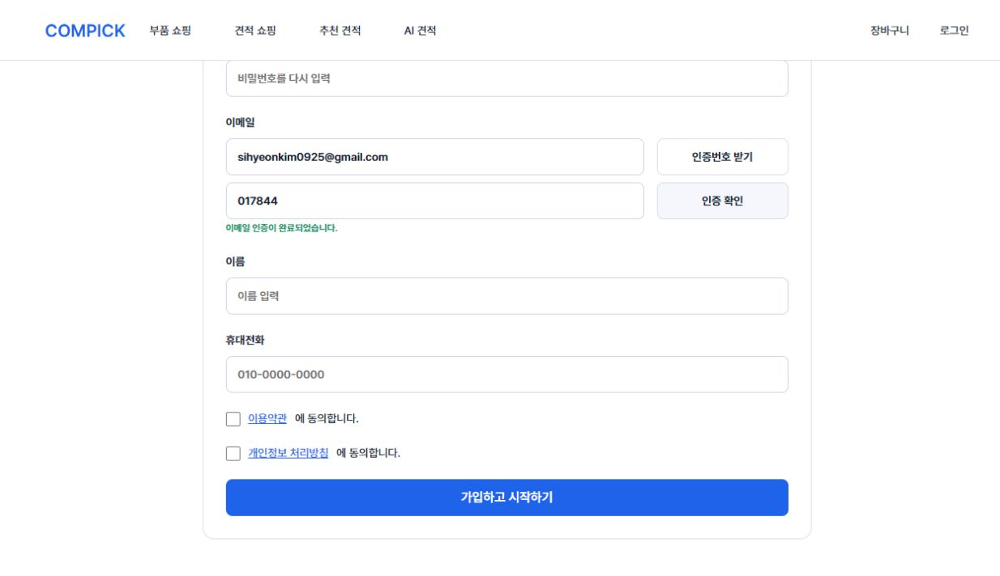
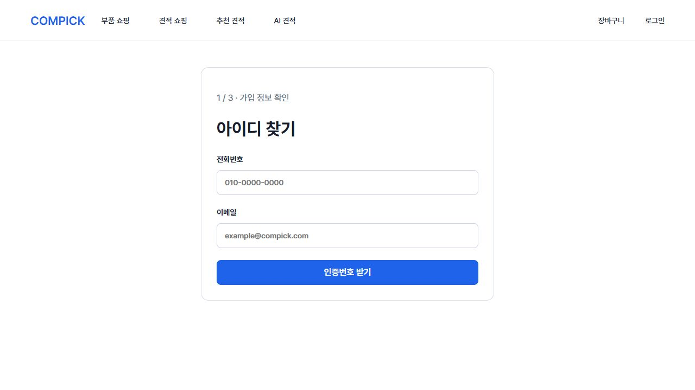
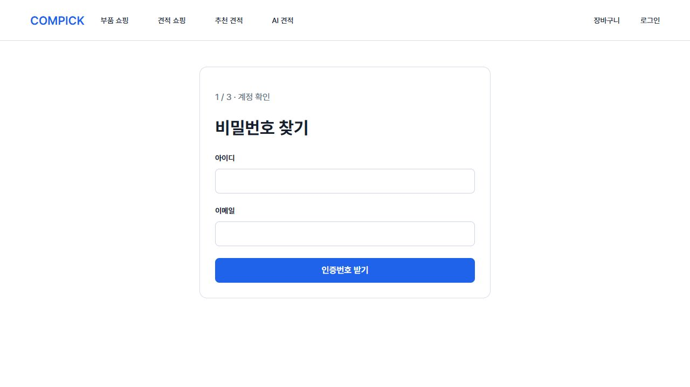
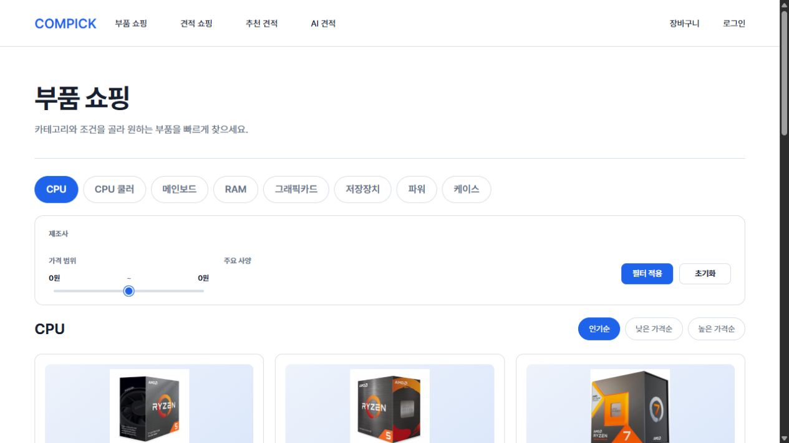
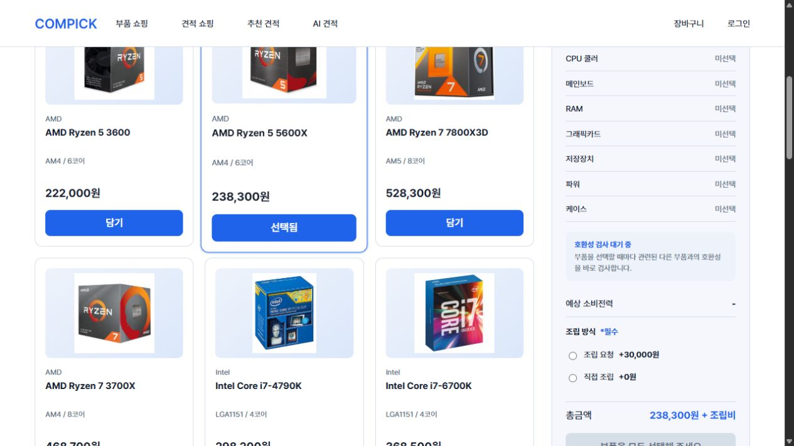
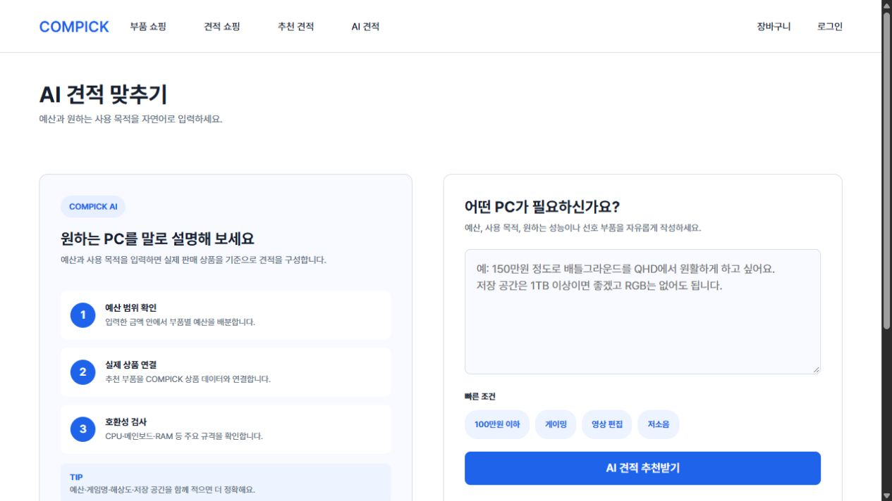

# 화면과 사용자 흐름

[프로젝트 소개](../README.md) · [기능과 구현 구조](FEATURES.md)

COMPICK은 부품을 직접 선택하는 사용자와 추천을 참고하는 사용자가 같은 주문 흐름으로 이어지도록 구성한 조립 PC 쇼핑몰입니다. 비회원도 상품과 견적을 탐색할 수 있으며, 로그인한 회원은 개인 장바구니·주문·배송지·AI 견적 이력을 관리하도록 구성하였습니다.

## 1. 메인 페이지

부품 쇼핑, 직접 견적, 추천 견적, AI 견적을 상단 메뉴에서 선택하도록 구성하였습니다. 인기 부품은 카테고리별로 전환하며 확인할 수 있도록 하였고, 부품을 직접 고르기 어려운 사용자는 추천 견적으로 이동하도록 안내하였습니다.

- **경로:** `/`
- **연결:** 부품 목록 → 상품 확인 / 직접 견적 → 부품 구성 / 추천·AI 견적 → 구성안 확인
- **구현:** [홈 컨트롤러](../src/main/java/com/boot/compick/home/controller/HomeController.java), [홈 템플릿](../src/main/resources/templates/home/index.html)

## 2. 로그인

아이디·비밀번호 입력과 로그인 상태 유지 기능을 제공하였습니다. Google 연동 설정이 있는 환경에서는 **Google로 계속하기** 버튼을 표시하여 소셜 로그인도 이용하도록 하였습니다. 로그인 화면에서 회원가입·아이디 찾기·비밀번호 재설정으로 이동하도록 연결하였습니다.

인증 실패 시 입력 화면에 안내 문구를 표시하도록 하였습니다. 장바구니·주문·마이페이지처럼 인증이 필요한 화면은 로그인 후 이용하도록 구분하였습니다.

| 항목 | 화면 동작 |
|---|---|
| 일반 로그인 | 아이디·비밀번호를 입력하여 로그인 |
| 로그인 상태 유지 | 다음 방문에서도 인증을 유지하도록 선택 |
| Google 로그인 | Google 계정으로 인증 후 서비스 계정과 연결 |
| 계정 지원 | 회원가입·아이디 찾기·비밀번호 재설정 화면으로 이동 |

- **경로:** `/login`
- **구현:** [로그인 화면](../src/main/resources/templates/member/login.html), [인증·권한 처리](../src/main/java/com/boot/compick/config/SecurityConfig.java)

## 3. 회원가입

아이디, 비밀번호와 확인값, 이메일, 이름, 전화번호를 입력하고 이용약관·개인정보 처리방침에 동의하여 가입하도록 구성하였습니다. 아이디 중복 확인과 이메일 인증을 가입 화면에서 진행하도록 하였습니다.

이메일로 받은 6자리 인증번호를 입력하면 인증 결과를 표시하고, 서버에서도 비밀번호 일치 여부·입력값·이메일 인증 완료 여부를 검사하도록 구현하였습니다. 가입이 완료되면 자동 로그인하여 메인 화면으로 이동하도록 하였습니다.

**화면 흐름:** 가입 정보 입력 → 아이디 중복 확인 → 이메일 인증번호 요청·확인 → 약관 동의 → 가입·자동 로그인

- **경로:** `/members/signup`
- **구현:** [회원가입 화면](../src/main/resources/templates/member/join.html), [회원 화면 제어](../src/main/resources/static/js/member.js), [가입 처리](../src/main/java/com/boot/compick/member/controller/MemberController.java)

### 이메일 인증

| 인증 메일 본문 | 사이트 인증 완료 |
|---|---|
|  |  |

이메일 입력란 옆에 인증번호 요청 버튼을 배치하고, 아래에 6자리 인증번호 입력란과 인증 확인 버튼을 구성하였습니다. 메일에는 인증번호와 5분의 유효시간을 안내하며, 인증이 완료되면 입력란 아래에 완료 메시지를 표시하도록 구현하였습니다.

## 4. 아이디 찾기·비밀번호 재설정

| 아이디 찾기 | 비밀번호 재설정 |
|---|---|
|  |  |

로그인 정보를 잊은 사용자가 이메일 인증을 거쳐 계정을 복구하도록 하였습니다. 아이디 찾기는 인증 후 계정 정보를 안내하고, 비밀번호 재설정은 인증 후 새 비밀번호를 설정하는 화면으로 연결하였습니다. 오류가 발생하면 해당 단계에서 안내하여 다시 입력하도록 구성하였습니다.

| 구분 | 화면 흐름 | 진입 경로 |
|---|---|---|
| 아이디 찾기 | 이메일 입력 → 인증번호 확인 → 아이디 안내 | `/members/find-id` |
| 비밀번호 재설정 | 계정 정보 입력 → 이메일 인증 → 새 비밀번호 설정 | `/members/password-reset` |

구현: [계정 복구 컨트롤러](../src/main/java/com/boot/compick/member/controller/RecoveryController.java), [이메일 인증 처리](../src/main/java/com/boot/compick/member/service/EmailVerificationService.java)

## 5. 부품 쇼핑

CPU, CPU 쿨러, 메인보드, RAM, 그래픽카드, 저장장치, 파워, 케이스의 8개 카테고리로 상품을 나누었습니다. 제조사·가격·카테고리별 상세 사양을 조합하고 인기순·가격순으로 정렬하도록 구현하였습니다. 상품 상세 정보는 모달로 확인하고 장바구니에 담도록 구성하였습니다.

첫 화면의 상품은 서버에서 렌더링하고, 이후 카테고리·필터 변경은 JavaScript에서 API를 호출하여 목록을 갱신하도록 하였습니다. 카테고리별로 필요한 사양이 달라 필터 선택지도 서버에서 조회하도록 구성하였습니다.

- **경로:** `/products`
- **화면 동작:** 카테고리 선택 → 필터 설정 → 목록 갱신 → 상세 모달 → 장바구니 담기
- **구현:** [상품 화면](../src/main/resources/templates/shopping/products.html), [목록 제어](../src/main/resources/static/js/products.js), [상세 모달](../src/main/resources/static/js/product-modal.js)

## 6. 견적서 작성

상품 목록과 내 견적서를 함께 배치하여 선택한 부품, 수량, 예상 소비전력, 총금액을 확인하도록 구현하였습니다. 부품을 바꾸면 견적서와 호환성 안내를 갱신하고, RAM과 저장장치는 여러 상품을 선택하도록 하였습니다.

CPU·메인보드 소켓, RAM 규격, 케이스 크기와 그래픽카드 길이 등을 비교하여 화면에 문제를 표시하도록 구현하였습니다. 조립 요청 또는 직접 조립을 선택하고 필수 구성을 채운 뒤 견적을 장바구니에 담도록 하였습니다. 화면의 호환성 안내와 서버의 저장 검증 범위는 [기능 문서](FEATURES.md#2-직접-견적과-호환성-안내)에 구분하여 정리하였습니다.

- **경로:** `/quotes/new`
- **화면 동작:** 카테고리별 부품 선택 → 구성·호환성 확인 → 조립 방식 선택 → 견적 저장 및 장바구니 담기
- **구현:** [견적 화면](../src/main/resources/templates/shopping/quote-new.html), [견적 구성 JavaScript](../src/main/resources/static/js/quote-builder.js)

## 7. 추천 견적

용도별로 미리 구성한 견적을 목록으로 제공하고, 상세 화면에서 구성 부품과 합계 금액을 확인하도록 하였습니다. 사용자는 추천 견적을 장바구니에 담거나 구성 변경 화면으로 이어가도록 하였습니다. 직접 부품을 하나씩 찾는 대신 구성안을 출발점으로 삼도록 만든 화면입니다.

- **경로:** `/preset`, `/preset/{quoteId}`
- **구현:** [추천 목록](../src/main/resources/templates/shopping/preset-list.html), [추천 상세](../src/main/resources/templates/shopping/preset-detail.html), [상세 화면 제어](../src/main/resources/static/js/preset-detail.js)

## 8. AI 견적

예산, 게임·작업 용도, 원하는 성능 등을 문장으로 입력하도록 하였습니다. 빠른 조건 버튼으로 요구사항 작성을 돕고, 추천 요청 후에는 추천 설명·실제 상품 목록·합계 금액을 표시하도록 구성하였습니다.

추천 결과는 Gemini가 반환한 상품 식별값을 서버의 상품 데이터와 연결하여 구성하였습니다. 로그인한 사용자는 결과를 자신의 견적으로 저장하여 장바구니로 이어가도록 하였으며, 추천 실패와 견적 저장 실패를 구분하여 안내하도록 하였습니다.

- **경로:** `/ai-quotes`
- **구현:** [AI 견적 화면](../src/main/resources/templates/shopping/recommendation/ai-quote.html), [입력 화면 제어](../src/main/resources/static/shopping/js/ai-recommendation.js)

## 9. 장바구니·주문서

장바구니에서는 개별 상품과 여러 부품으로 구성된 견적을 구분하여 표시하고, 수량 변경·선택·삭제를 지원하도록 하였습니다. 선택한 항목만 주문서로 이어지도록 구성하였습니다.

주문서에서는 주문 대상과 배송지를 확인하고, 새 배송지를 등록하거나 기존 배송지를 선택하도록 하였습니다. 결제 버튼을 누르면 서버에서 결제 대기 주문을 생성한 뒤, 서버가 반환한 주문 번호와 금액으로 Toss Payments 결제창을 요청하도록 구현하였습니다.

| 화면 | 경로 | 주요 역할 |
|---|---|---|
| 장바구니 | `/cart` | 상품·견적 수량 및 주문 대상 선택 |
| 주문서 | `/orders/new` | 선택 항목·배송지 확인, 결제 요청 |
| 결제 결과 | `/payments/success`, `/payments/fail` | 서버 승인 결과 또는 실패 사유 안내 |

구현: [장바구니 화면](../src/main/resources/templates/cart/index.html), [장바구니 제어](../src/main/resources/static/js/cart.js), [주문 화면](../src/main/resources/templates/order/new.html), [주문·결제 요청](../src/main/resources/static/js/order.js)

## 10. 마이페이지

주문 목록에서 상태별 내역을 확인하고, 주문 상세에서 상품 구성·결제 정보·배송지를 확인하도록 하였습니다. 주문 상태에 따라 취소·반품 요청을 처리하도록 구성하였습니다. 마이페이지에는 최근 AI 견적 이력도 연결하였습니다.

| 구분 | 경로 | 제공 기능 |
|---|---|---|
| 마이페이지 | `/mypage` | 계정·주문·최근 AI 견적 진입 |
| 주문 내역 | `/orders`, `/orders/{orderNumber}` | 상태별 조회, 상세 확인, 취소·반품 요청 |
| 회원 정보 | `/mypage/profile` | 회원 정보 및 비밀번호 변경 |
| 배송지 | `/mypage/addresses` | 배송지 등록·수정·삭제·기본 배송지 지정 |

### 회원 정보·배송지 관리

회원 정보 화면에서 가입 정보를 수정하고 현재 비밀번호를 확인하여 비밀번호를 변경하도록 하였습니다. 배송지는 여러 개를 등록·수정·삭제하고 기본 배송지를 지정하도록 구성하였습니다. 등록한 배송지는 주문서에서 선택하여 사용하도록 연결하였습니다.

개인 주문·배송지·견적은 로그인 회원을 기준으로 조회하도록 하여 다른 회원의 정보에 접근하지 못하도록 처리하였습니다.

구현: [회원 화면 컨트롤러](../src/main/java/com/boot/compick/member/controller/MemberController.java), [계정 복구](../src/main/java/com/boot/compick/member/controller/RecoveryController.java), [주문 상세 제어](../src/main/resources/static/js/order-detail.js)

## 11. 관리자 페이지

관리자 전용 화면에서 판매 상품, 추천 견적, 회원, 주문, AI 추천 기록을 관리하도록 구현하였습니다. 메뉴를 숨기는 데 그치지 않고 서버에서 관리자 권한을 검사하도록 구성하였습니다.

| 화면 | 경로 | 제공 기능 |
|---|---|---|
| 대시보드 | `/admin` | 운영 현황 확인 |
| 상품 관리 | `/admin/products` | 상품 조회·등록·수정 |
| 추천 견적 관리 | `/admin/presets` | 용도별 구성안 조회·등록·수정·삭제 |
| 회원 관리 | `/admin/members` | 회원 검색·상세 조회·정보 변경 |
| 주문 관리 | `/admin/orders` | 주문 검색·상세 조회·상태 변경 |
| AI 로그 | `/admin/ai-logs` | 저장된 추천 요청과 결과 확인 |

구현: [관리자 컨트롤러](../src/main/java/com/boot/compick/admin/AdminController.java)

