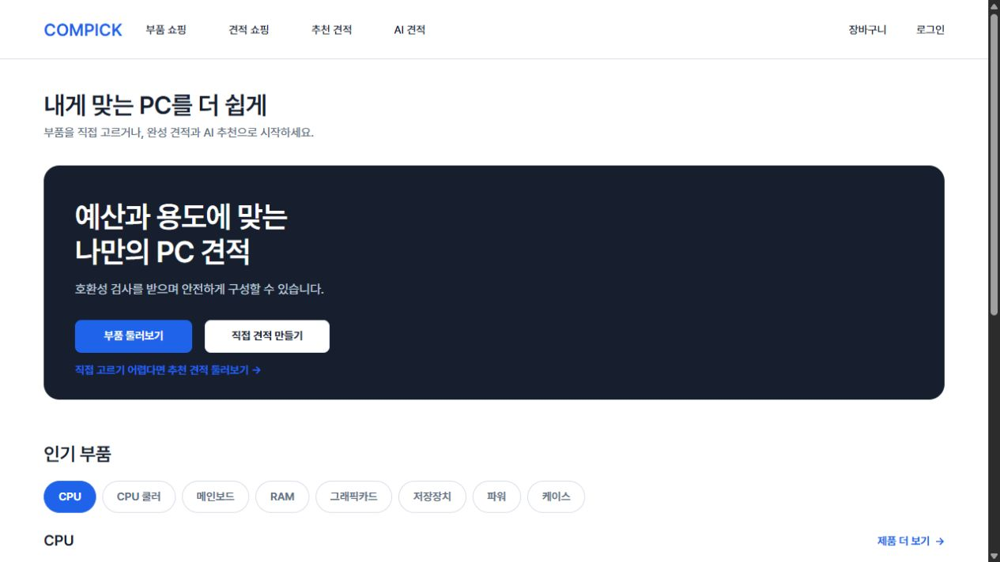
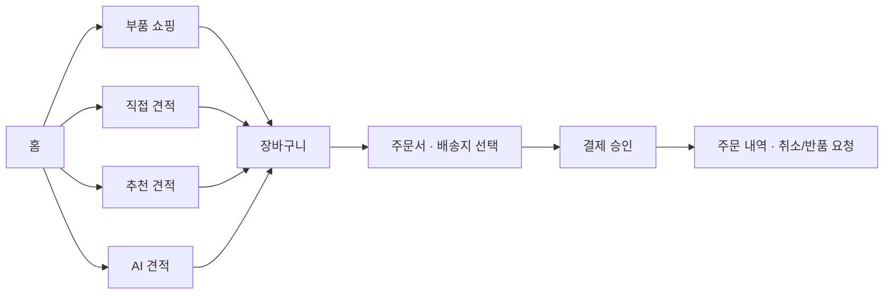

# COMPICK — 조립 PC 쇼핑몰

부품을 직접 고르거나 추천 견적·AI 견적으로 PC를 구성하고, 장바구니에서 주문과 결제로 이어갈 수 있도록 개발한 쇼핑몰 팀 프로젝트입니다.

부품을 잘 아는 사용자는 조건별 탐색과 직접 견적을, 구성이 어려운 사용자는 용도별 추천과 자연어 요구사항 입력을 이용하도록 하였습니다. 또한 상품·견적·주문을 관리하는 관리자 화면을 구현하였습니다.

## 주요 기능

| 기능 | 구현 내용 |
|---|---|
| 부품 쇼핑 | 8개 부품 카테고리, 제조사·가격·상세 사양 필터, 정렬, 상품 상세 모달 |
| 직접 견적 | 구성 부품·수량 관리, 호환성 안내, 예상 소비전력·합계 표시, 조립 방식 선택 |
| 추천·AI 견적 | 용도별 완성 견적, 자연어 요구사항 기반 Gemini 추천, 실제 상품 연결 |
| 장바구니·주문 | 개별 상품·견적 통합 관리, 주문 대상 선택, 배송지 지정, 주문 생성 |
| 결제·구매 내역 | Toss Payments 승인·취소 연동, 재고 처리, 주문 상태별 조회·취소·반품 요청 |
| 회원·관리자 | 이메일 인증·계정 복구·배송지 관리, 관리자 상품·견적·회원·주문·AI 로그 관리 |

## 서비스 흐름

## 구현 방식

| 영역 | 사용 기술 | 구현 내용 |
|---|---|---|
| 서버 | Java 21 · Spring Boot · Spring MVC | 화면과 API를 같은 서버에서 제공, Controller–Service–Repository 분리 |
| 화면 | Thymeleaf · HTML · CSS | 서버 데이터 렌더링, 공통 헤더·푸터 템플릿 구성 |
| 화면 갱신 | JavaScript · Fetch API | 상품 필터·상세 모달·견적·장바구니를 비동기로 갱신 |
| 요청 처리 | MVC Controller · REST Controller · DTO | 화면 요청과 JSON 응답 구분, 입력 검증 및 오류 처리 |
| 데이터 | Spring Data JPA · Oracle | 상품·견적·주문 저장, 금액 검증과 결제·재고 상태 변경 |
| 인증·권한 | Spring Security · Google OAuth2/OIDC | 일반·소셜 로그인, 회원·관리자 접근 및 개인 데이터 소유자 확인 |
| AI 추천 | Gemini API · Google Gen AI SDK | 요구사항 기반 견적 추천, 추천 상품을 실제 상품 데이터와 연결 |
| 결제 | Toss Payments SDK · API | 결제창 요청, 서버 승인·취소 및 주문 금액 대조 |
| 이메일 | JavaMailSender · SMTP | 회원가입·계정 찾기·비밀번호 재설정 인증번호 발송 |

## 데이터셋

- PC 부품 데이터: [PCPartPicker Parts Dataset](https://huggingface.co/datasets/Doshiba/pcpartpicker-parts-dataset) — PCPartPicker에서 수집한 상품·사양 데이터의 공개 데이터셋을 전처리/가공하여 구축하였습니다.

## 상세 문서

- **[USERFLOW](docs/PAGES.md)** — 화면구현 및 사용자흐름.
- **[기능 구현](docs/FEATURES.md)** — 화면·API·서비스·데이터의 연결, 처리 순서

## 개선사항

[교육 수료 후 진행한 추가 개선](docs/IMPROVEMENTS.md) · [화면 비교·개선효과](docs/IMPROVEMENT_RESULTS.md)
