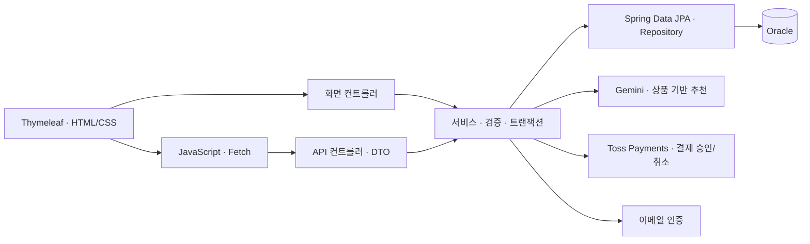
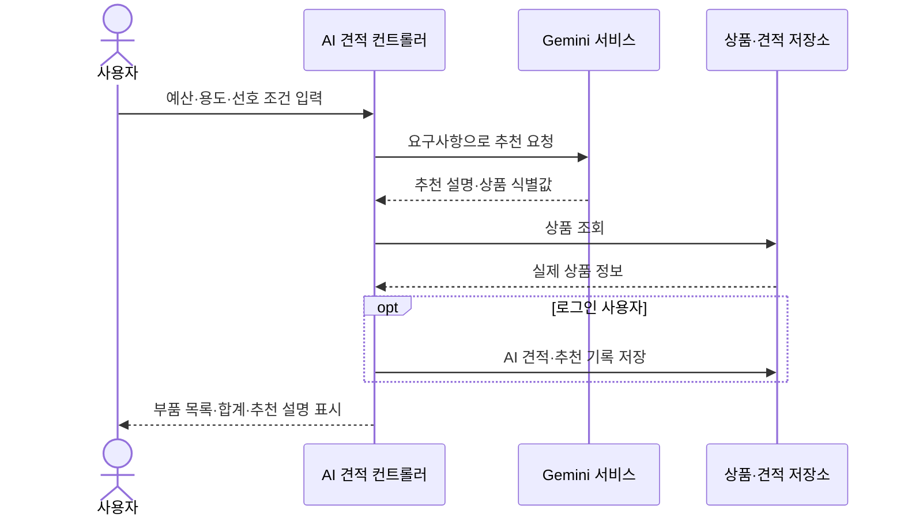
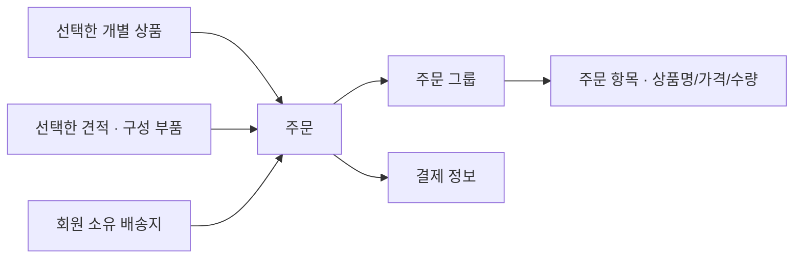

# 기능과 구현 구조

[프로젝트 소개](../README.md) · [화면과 사용자 흐름](PAGES.md)

## 아키텍처

Spring MVC와 Thymeleaf로 화면을 제공하고, 필터·견적·장바구니처럼 사용자 조작이 잦은 영역은 JavaScript의 Fetch API로 갱신하도록 구성하였습니다. 별도의 SPA 서버를 두지 않은 서버 렌더링 기반 구조이며, 화면을 반환하는 컨트롤러와 JSON을 반환하는 API 컨트롤러를 구분하였습니다.

| 계층 | 담당 역할 | 대표 코드 |
|---|---|---|
| 화면 | 서버 렌더링, 입력 폼, 상품·견적 표시 | [상품 템플릿](../src/main/resources/templates/shopping/products.html) |
| 브라우저 | 필터 상태, 비동기 조회, 선택 항목·금액 갱신 | [products.js](../src/main/resources/static/js/products.js), [quote-builder.js](../src/main/resources/static/js/quote-builder.js) |
| 컨트롤러 | 요청 바인딩, 인증 사용자 전달, 응답·오류 안내 | [상품 API](../src/main/java/com/boot/compick/product/controller/ProductApiController.java) |
| 서비스 | 도메인 규칙, 소유자 확인, 저장·상태 변경 | [주문 서비스](../src/main/java/com/boot/compick/order/service/OrderService.java) |
| 저장소 | 엔티티 조회·저장, 조건 검색 | [상품 저장소](../src/main/java/com/boot/compick/product/repository/ProductRepository.java) |

## 1. 상품 탐색과 카테고리별 필터

**사용자 동작:** 카테고리와 제조사·가격·사양 조건을 선택하면 해당 조건의 상품 목록을 표시하도록 구현하였습니다.

- **프론트엔드:** 초기 목록은 Thymeleaf로 표시하고, 조건 변경 시 API 결과로 상품 카드를 갱신하도록 하였습니다. 상세 정보는 별도 API를 조회하여 모달에 표시하도록 구성하였습니다.
- **백엔드:** `GET /api/products`에서 조건과 정렬·페이지 값을 받아 JPA Specification을 조합하도록 구현하였습니다. 판매 중인 상품을 기준으로 카테고리·브랜드·가격·저장장치 유형·상세 사양 조건을 적용하였습니다.
- **데이터:** 공통 상품 속성과 카테고리별 `specJson`을 함께 사용하였습니다. `GET /api/products/{category}/facets`로 제조사·가격 범위·사양 선택지를 조회하도록 하였습니다.

예를 들어 메인보드에서는 소켓·메모리 규격·폼팩터를, 파워에서는 정격 출력·효율을 필터 후보로 제공하도록 구성하였습니다. 인기순은 `ratingCount`와 등록일을 기준으로 정렬하였습니다.

구현: [ProductService](../src/main/java/com/boot/compick/product/service/ProductService.java), [검색 조건](../src/main/java/com/boot/compick/product/repository/ProductSpecifications.java)

## 2. 직접 견적과 호환성 안내

**사용자 동작:** 8개 카테고리의 부품을 선택하고 구성·수량·조립 방식을 확인한 뒤 견적을 장바구니에 담도록 구현하였습니다.

| 처리 위치 | 구현 내용 |
|---|---|
| 브라우저 | 선택 부품과 수량 관리, 합계·조립비 표시, 예상 소비전력 및 호환성 안내 갱신 |
| 브라우저 | CPU·메인보드 소켓, RAM·메인보드 메모리 규격, 케이스·메인보드 크기 비교 |
| 브라우저 | GPU 길이·케이스 허용 길이, 파워 용량, HDD 베이 수 비교 |
| 서버 | 상품 존재 여부, 8개 필수 카테고리, 단일·다중 선택 규칙, RAM 슬롯 수 검증 |
| 저장 | 견적과 구성 상품·수량을 저장하고 회원 장바구니에 연결 |

RAM과 저장장치는 다중 선택을 허용하고, 다른 카테고리는 한 상품을 선택하도록 하였습니다. 서버의 RAM 슬롯 검증은 상품 1개를 RAM 2개 구성으로 계산하도록 작성하였습니다.

**검증 범위:** 화면의 호환성 검사는 상품에 해당 사양 값이 존재할 때 수행하는 안내입니다. 서버 검증이 화면의 모든 호환성 규칙을 재검사하는 구조는 아니며, 실제 부품의 모든 장착 가능성을 보장하지는 않습니다.

구현: [브라우저 견적 처리](../src/main/resources/static/js/quote-builder.js), [서버 선택 검증](../src/main/java/com/boot/compick/quote/service/QuoteSelectionValidator.java), [견적 저장](../src/main/java/com/boot/compick/quote/service/QuoteService.java)

## 3. 추천 견적과 AI 견적의 구매 연결

추천 견적은 관리자가 구성한 공개 견적을 용도별로 조회하도록 하였습니다. AI 견적은 사용자의 요구사항을 Gemini에 전달하고, 반환된 상품 식별값을 실제 상품 데이터에 연결하도록 구현하였습니다.

서버 시작 시 판매 중이고 재고가 있는 DB 상품으로 추천용 CSV를 구성하여 Gemini에 업로드하고 시스템 프롬프트를 읽도록 구성하였습니다. 추천 결과의 합계는 연결된 상품 가격으로 계산하도록 하였습니다. 로그인한 사용자의 결과는 견적과 추천 기록으로 저장하여 장바구니·최근 견적 이력으로 연결하였습니다.

입력 검증 오류, 빈 응답, 상품 식별값 누락, 응답 해석 실패를 처리하도록 하였습니다. 추천 요청은 성공했지만 견적 저장이 실패한 경우에는 추천 내용과 별도로 장바구니 연계 오류를 표시하도록 하였습니다. 공개 추천 견적 외의 개인 견적은 소유자를 확인한 뒤 장바구니에 추가하도록 하였습니다.

구현: [AI 컨트롤러](../src/main/java/com/boot/compick/shopping/recommendation/controller/AiRecommendationController.java), [Gemini 서비스](../src/main/java/com/boot/compick/shopping/recommendation/service/GeminiRecommendationService.java), [AI 견적 저장](../src/main/java/com/boot/compick/quote/service/AiQuoteService.java), [추천 프롬프트](../src/main/resources/shopping/ai/system-prompt.txt)

## 4. 장바구니에서 주문 데이터로 전환

**프론트엔드:** 상품과 견적의 수량·선택 상태·삭제 요청을 API로 전달하도록 하였습니다. 주문서에서는 장바구니와 배송지를 병렬 조회하고, 선택 항목과 배송지 상태에 따라 결제 버튼을 제어하도록 하였습니다. 상태 변경 요청에는 페이지에 포함된 CSRF 토큰을 헤더로 전달하도록 구현하였습니다.

**백엔드:** 주문 생성 시 브라우저가 보낸 가격을 그대로 저장하지 않고, 로그인 회원의 선택된 장바구니 항목과 서버 상품 가격을 조회하여 주문 금액을 계산하도록 하였습니다. 배송지는 ID만 확인하는 대신 로그인 회원 소유인지 함께 조회하도록 하였습니다.

**저장 구조:** 개별 상품과 견적을 주문 그룹으로 구분하고, 견적에 포함된 부품은 그룹의 주문 항목으로 저장하도록 하였습니다. 주문 시점의 상품명·단가·수량과 수령인·주소를 주문 데이터에 복사하여 이후 조회에 사용하도록 구성하였습니다.

구현: [CartService](../src/main/java/com/boot/compick/cart/service/CartService.java), [OrderService](../src/main/java/com/boot/compick/order/service/OrderService.java), [주문 화면 제어](../src/main/resources/static/js/order.js)

## 5. 결제 승인·재고·주문 상태

결제창 요청과 서버 승인을 분리하였습니다. 주문서에서 결제 대기 주문을 생성한 뒤 서버 응답의 주문 번호·최종 금액으로 Toss Payments SDK를 호출하도록 하였습니다.

서버의 승인 처리 순서는 다음과 같이 구현하였습니다.

1. 주문 존재 여부와 소유자를 확인하고 결제 대기 상태인지 검사하였습니다.
2. 콜백 금액과 서버에 저장한 주문 금액이 일치하는지 검사하였습니다.
3. 상품별 수량을 합산하여 재고를 예약하고 READY 결제 정보를 저장한 뒤 DB 트랜잭션을 종료하도록 하였습니다.
4. DB 잠금 없이 Toss Payments 승인 API를 호출하고, 결과를 대조한 뒤 별도 트랜잭션에서 결제·주문 완료를 저장하도록 하였습니다.
5. 구매한 항목을 장바구니에서 제거하도록 하였습니다.

서비스의 DB 변경에는 Spring 트랜잭션을 적용하였습니다. 주문의 재고 차감·복원 표시를 확인하여 같은 주문에서 중복 재고 처리를 방지하도록 하였습니다. 이는 외부 결제 API와 DB를 하나의 분산 트랜잭션으로 처리한다는 의미는 아닙니다.

주문 취소는 주문 상태를 확인한 뒤 승인된 결제가 있으면 취소 API를 호출하고 재고를 복원하도록 하였습니다. 반품은 배송 중·배송 완료 주문에서 허용하도록 하였습니다. 반품 요청과 관리자 승인을 분리하고, 승인 시 남은 결제 잔액 전액을 환불한 뒤 재고를 복원하도록 하였습니다. 결제 결과가 불확실하면 저장된 결제 키를 재조회하여 복구하도록 하였습니다.

구현: [결제 서비스](../src/main/java/com/boot/compick/payment/service/PaymentService.java), [Toss 연동](../src/main/java/com/boot/compick/payment/service/TossPaymentService.java), [결제 결과 컨트롤러](../src/main/java/com/boot/compick/payment/controller/PaymentController.java)

## 6. 인증·계정 복구·개인 데이터 접근

일반 로그인과 Google OIDC 로그인 경로를 구성하였습니다. 비밀번호는 PasswordEncoder를 통해 해시하여 저장하고, 소셜 계정의 추가 인증 정보 설정 화면을 연결하였습니다.

| 구분 | 처리 내용 |
|---|---|
| 접근 권한 | 쇼핑 탐색은 공개, 장바구니·주문·마이페이지는 인증 필요, 관리자 경로는 ADMIN 권한 필요 |
| 비로그인 응답 | API 요청은 401, 화면 요청은 로그인 페이지로 이동 |
| 개인 데이터 | 주문·배송지·개인 견적을 로그인 회원 기준으로 조회 |
| 이메일 인증 | 6자리 인증번호, 5분 만료, 1분 재요청 제한, 최대 5회 시도 |
| 인증 저장 | 인증번호를 해시하여 저장하고 사용 여부·인증 목적을 검사 |
| 배송지 | 기본 배송지 변경 시 기존 지정을 해제하고, 기본 배송지 삭제 시 남은 배송지 중 하나를 지정 |

구현: [SecurityConfig](../src/main/java/com/boot/compick/config/SecurityConfig.java), [이메일 인증](../src/main/java/com/boot/compick/member/service/EmailVerificationService.java), [회원 서비스](../src/main/java/com/boot/compick/member/service/MemberService.java), [배송지 서비스](../src/main/java/com/boot/compick/member/service/AddressService.java)

## 7. 관리자와 판매 데이터 관리

상품 등록·수정, 추천 견적 구성·삭제, 회원 조회·정보 변경, 주문 상태 변경, AI 추천 로그 조회를 관리자 화면에 연결하였습니다. 고객 화면에서 사용하는 상품·추천 견적 데이터를 관리자 화면에서 관리하도록 하였으며, 관리자 URL 접근은 Spring Security에서 제한하였습니다.

구현: [관리자 컨트롤러](../src/main/java/com/boot/compick/admin/AdminController.java), [추천 견적 관리 서비스](../src/main/java/com/boot/compick/quote/service/PresetAdminService.java)
