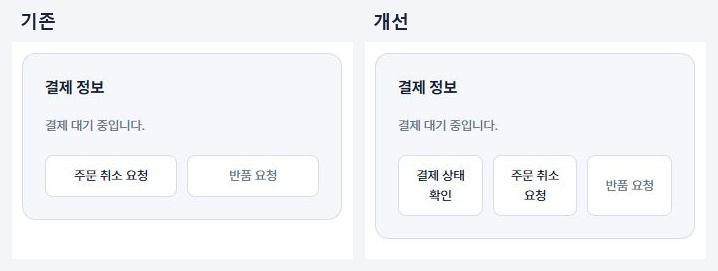
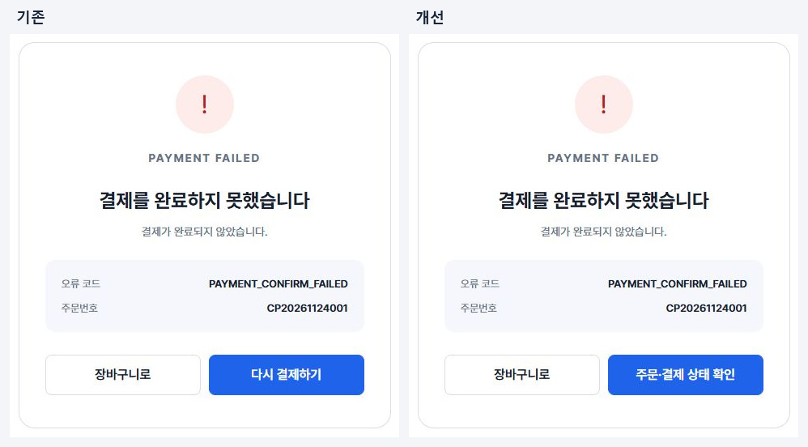
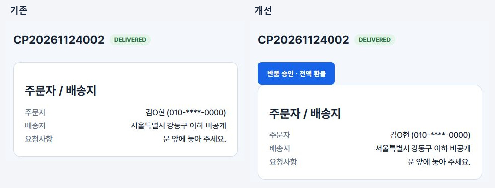

# 화면 비교와 개선효과

[프로젝트 소개](../README.md) · [개선 내용과 구현](IMPROVEMENTS.md)

## 개선효과

| 구분 | 변경 | 효과 |
|---|---|---|
| 동시 처리 지연 | 외부 승인 대기를 DB 트랜잭션 밖으로 분리 | 아래 모의 부하에서 평균 처리 시간 **1,312ms → 537ms**, **59.1% 감소** |
| DB 연결 점유 | 승인 요청 전에 재고 예약을 커밋하고 연결 반환 | 측정한 외부 승인 40회 중 DB 트랜잭션 안에서 대기한 호출 **40회 → 0회** |
| 주문·재고 정합성 | UUID 주문 번호, 주문·상품 잠금, 차감·복원 기록 | 재고 3개에 8건 동시 결제 시 3건 승인·잔여 재고 0개, 같은 주문의 반복 승인 시 외부 승인 1회 |
| 결제 복구 | 결제 키·예약을 먼저 저장하고 승인 결과 재조회 | 외부 승인 후 로컬 저장 실패를 추가 승인 없이 복구하도록 구성 |
| 서버 검증 | 공통 호환성 검사, 현재 DB 상품·가격 기준 AI 검사 | 화면 검사를 우회한 요청과 잘못된 추천 결과를 저장·구매 흐름에서 차단 |
| 요청 제어 | 중복 제출 방지, 변경 요청 자동 재전송 금지 | 연속 클릭·네트워크 오류에 따른 변경 요청 중복 실행 위험 축소 |
| 반품 처리 | 요청·관리자 승인·환불 완료 구분 | 요청만으로 환불하지 않고 승인 시 환불·재고 복원, 반복 승인 중복 처리 방지 |

주문·결제·견적 관련 항목은 자동 테스트와 구현을 기준으로 정리하였습니다. 보안 전체의 향상률이나 실제 결제사 응답속도 향상으로 환산하지 않았습니다.

## 1. 화면 비교

화면 전체의 디자인은 유지하고, 결제 복구와 반품 승인에 필요한 조작부를 추가하였습니다. 같은 예시 주문을 넣은 기존·개선 버전의 실행 화면을 비교하였습니다. 테스트용 이름은 **김O현**, 주소는 **서울특별시 강동구**로 통일하였습니다.

### 주문 상세: 결제 결과 다시 확인하기

결제 대기 주문에 **결제 상태 확인** 버튼을 추가하였습니다. 승인 응답을 받지 못한 경우 같은 주문의 결제 결과를 다시 조회하여 상태를 반영하도록 하였습니다.

### 결제 실패: 재결제보다 기존 주문 확인을 먼저 안내하기

기존 **다시 결제하기** 버튼을 **주문·결제 상태 확인**으로 변경하였습니다. 승인 여부가 불확실한 상황에서 기존 주문을 확인하고 복구하는 흐름으로 연결하였습니다.

### 관리자 주문 상세: 반품 승인 단계 추가하기

반품 요청이 접수된 주문에 **반품 승인 · 전액 환불** 버튼을 추가하였습니다. 회원의 반품 요청과 관리자의 환불 승인을 분리하고, 완료 이후에는 반품 환불 완료 상태를 표시하도록 하였습니다.

요청 중 버튼 비활성화, 실패 안내, 요구사항 입력값 유지는 공통 요청 처리에 반영하였습니다. 서버 검증·재고 잠금·자동 복구는 화면 디자인의 변경 없이 동작하도록 하였습니다.

## 2. 처리 지연 측정

### 측정 조건

| 항목 | 조건 |
|---|---|
| 기준 코드 | `76ac6ee`의 루트 코드와 `reforege` 코드 |
| 환경 | 동일 Windows PC, Amazon Corretto Java 21.0.10, Spring Boot 3.5.16, H2 2.3.232 Oracle 모드 |
| 외부 승인 | 실제 결제 API 대신 **500ms 지연을 주는 모의 승인** |
| DB 연결 | HikariCP 최대 2개 |
| 동시 요청 | 서로 다른 상품·주문 8건을 동시에 승인 |
| 반복 | 버전별 준비 요청 4건 후 5회 반복, 측정 요청 각 40건 |
| 측정 범위 | `PaymentService.confirmToss` 진입부터 DB 반영이 끝난 반환 시점까지 |
| 결과 검사 | 버전별 40건의 결제 완료 상태와 상품별 재고 1회 차감 확인 |

### 결과

| 지표 | 기존 | 개선 | 변화 |
|---|---:|---:|---:|
| 요청 평균 | 1,312.3ms | 536.8ms | 59.1% 감소 |
| 요청 중앙값 | 1,308.8ms | 537.1ms | 59.0% 감소 |
| 요청 P95 | 2,106.2ms | 551.6ms | 73.8% 감소 |
| 동시 8건 전체 완료 평균 | 2,098.2ms | 548.4ms | 73.9% 감소 |
| 외부 호출 중 DB 트랜잭션 활성 | 40/40회 | 0/40회 | 외부 대기를 DB 트랜잭션에서 분리 |
| 결제 완료·재고 일치 | 40/40건 | 40/40건 | 비교 대상 모두 정상 완료 |

P95는 측정 요청의 95%가 해당 시간 이내에 끝났다는 의미입니다. 40개 표본을 정렬한 뒤 38번째 값을 사용하였습니다.

### 지연이 줄어든 이유

기존에는 승인 응답을 기다리는 동안 DB 트랜잭션과 연결을 유지하였습니다. 연결 2개가 승인 대기에 묶이면 나머지 요청은 연결을 기다려야 하였습니다.

개선 버전에서는 재고 예약을 먼저 커밋하고 외부 승인 대기 중에는 DB 연결을 반환하도록 하였습니다. 승인 결과를 받은 뒤 짧은 트랜잭션으로 완료를 반영하여, 동일한 연결 수에서도 다른 요청이 먼저 DB 작업을 진행할 수 있도록 하였습니다.

**이 수치는 DB 연결 부족 상황을 재현한 모의 부하 결과입니다.** 실제 Toss Payments·Oracle·HTTP 요청 전체의 응답속도나 일반 사용 환경의 평균 속도를 측정한 결과는 아닙니다. 외부 승인 자체의 500ms는 두 버전에서 동일하게 설정하였습니다.

원본 측정값: [기존 40건](benchmarks/payment-before.json) · [개선 40건](benchmarks/payment-after.json) · [집계](benchmarks/payment-summary.json)

측정 코드: [Java 서비스 비교](../tools/ComparisonLauncher.java) · [격리 실행 도구](../tools/benchmark_payments.py)

## 3. 검증과 안정성

| 항목 | 보완한 부분 | 확인 근거 |
|---|---|---|
| 상품 구성 검증 | 기존 필수 구성·일부 수량 검사에 소켓·메모리·장착 규격·전력·재고 검사를 추가 | 호환성 충돌, 필수 부품 누락, 판매 재고 및 수량 테스트 |
| AI 응답 검증 | 상품명 연결 대신 DB ID를 사용하고 예산을 현재 가격으로 재검사 | 존재하지 않는 상품·중복 ID·예산 초과 거부 테스트 |
| 승인 결과 검증 | 외부 응답의 주문 번호·결제 키·금액·완료 상태 대조 | 결제 결과 대조와 재조회 복구 테스트 |
| 결제 상태 충돌 | 처리 기한·멱등 키·주문 잠금으로 같은 결제의 중복 진행 제한 | 같은 주문의 승인 요청 8건에서 외부 승인 1회 |
| 환불 통제 | 요청만 기록하고 관리자 승인에서 환불, 완료 후 중복 승인 방지 | 요청 시 환불 없음, 승인 반복 시 환불·재고 복원 각 1회 |

회원별 주문 소유권, 관리자 권한, CSRF 검증은 기존 보안 구성을 유지하였습니다. 새 결제 복구·반품 승인 경로에도 해당 권한 범위를 적용하였습니다. 새로운 인증 체계를 도입하거나 보안 취약점 전체를 점검하였다는 의미로 기재하지 않았습니다.

현재 자동 테스트는 **Java 64개·Python 7개·JavaScript 4개로 총 75개**이며, 처리 지연 측정 80건은 해당 테스트 개수와 별도로 집계하였습니다.

## 4. 데이터 정리 효과

상품 전처리 스크립트에서 기존 CSV 543행 중 카테고리·브랜드·이름·사양이 같은 중복 12행을 제거하여 531행을 생성하였습니다. 입력 파일의 해시, 환율·선정 설정, 제외 건수를 기록하여 같은 입력과 설정에서 결과를 재현할 수 있도록 하였습니다.

생성 데이터를 운영 DB에 적용하지 않았으므로 DB 용량·AI 토큰·검색 속도 감소 수치로 표현하지 않았습니다.
